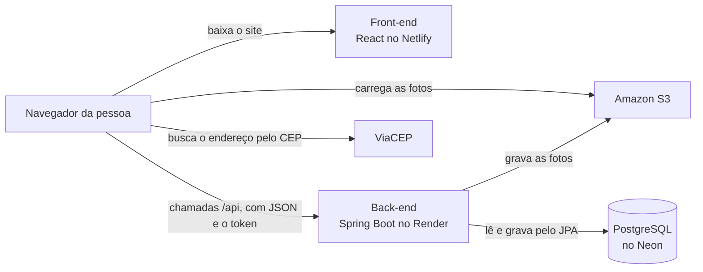
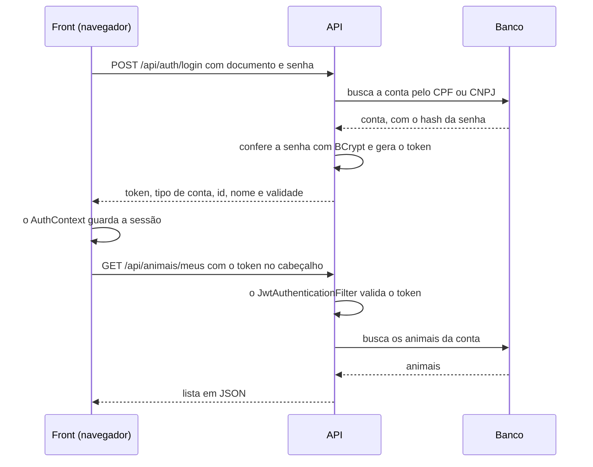

# Arquitetura do Adota Aqui

Como o sistema é organizado: as partes, onde cada uma roda e o caminho que os dados fazem. Os detalhes de cada endpoint estão no [contrato da API](api.md), e as tabelas e os campos, nos [diagramas](diagramas/diagramas-adota-aqui.md).

## Visão geral

O Adota Aqui é dividido em duas aplicações separadas, que só conversam por HTTP, trocando JSON:

- **Front-end:** o site que a pessoa abre no navegador. Monta as telas e chama a API.
- **Back-end:** a API REST. Guarda as regras de negócio, confere quem está logado e é o único que fala com o banco de dados.

O front não acessa o banco, e o back não monta tela. O combinado entre os dois é o `docs/api.md`: enquanto os dois lados seguirem o contrato, cada squad trabalha no seu sem travar o outro.



Repare que quem chama a API é o próprio navegador: o Netlify só entrega os arquivos do site, e o código do React roda na máquina da pessoa.

### Onde cada parte roda

| Parte             | Onde roda                                                      | Endereço                        |
| ----------------- | -------------------------------------------------------------- | ------------------------------- |
| Front-end         | Netlify, que também gera uma prévia de cada PR                 | https://adotaaqui.netlify.app   |
| Back-end          | Render, num container Docker montado pelo `backend/Dockerfile` | https://adota-aqui.onrender.com |
| Banco de dados    | PostgreSQL no Neon                                             | Só o back acessa                |
| Fotos dos animais | Amazon S3                                                      | Cada foto tem a sua URL pública |

A API do Render "dorme" depois de 15 minutos sem uso, e o primeiro acesso depois disso pode levar cerca de 1 minuto.

A configuração de cada ambiente vem de variáveis de ambiente, definidas no painel de cada serviço e nunca no repositório:

- **Render (back):** `DB_URL`, `DB_USERNAME` e `DB_PASSWORD` (banco), `JWT_SECRET` (chave do token), `CORS_ORIGENS` (quais sites podem chamar a API), `FOTOS_ARMAZENAMENTO=s3`, `FOTOS_URL_BASE`, `S3_BUCKET` e `AWS_REGION` (fotos), além das credenciais da AWS, que o SDK lê sozinho.
- **Netlify (front):** `VITE_API_URL`, o endereço da API.

Na máquina de vocês, sem variável nenhuma, o front roda em `http://localhost:5173`, o back em `http://localhost:8080` com um PostgreSQL local (banco `adota_aqui`), e as fotos ficam na memória. O passo a passo está no [README principal](../README.md).

## Front-end

**Tecnologias:** React 18 com Vite, Tailwind CSS e React Router. Testes com Jest e Testing Library.

```
frontend/src/
├── pages/        uma pasta por tela (Login, ListaAnimais, PerfilAnimal, InteressesRecebidos...)
├── components/   pedaços reaproveitados entre as telas (Botao, CardAnimal, FiltrosAnimais...)
├── routes/       todas as rotas (AppRoutes) e a RotaProtegida
├── contexts/     o AuthContext, que guarda quem está logado
├── services/     as chamadas à API, um arquivo por assunto, e a consulta ao ViaCEP
├── hooks/        hooks próprios (useValorAtrasado, useFocoNoPrimeiroErro, useTema)
├── utils/        máscaras, validações e os textos que traduzem os valores da API
├── config/       o endereço da API (ambiente.js)
├── styles/       o CSS global e as cores dos dois temas
├── assets/       os logos e as fotos da página inicial e das telas de aviso
└── mocks/        dados de exemplo usados pelos testes
```

**Rotas.** Todas ficam no `AppRoutes`. As públicas (vitrine, perfil do animal, login e cadastro) abrem para qualquer pessoa. As que precisam de login ficam dentro da `RotaProtegida`, que manda pro `/login` quem não entrou e, depois do login, devolve a pessoa pra tela de onde ela veio. Demonstrar interesse e Meus interesses usam a `RotaProtegida` com `apenasUsuario`, que barra o Abrigo (RF14: só pessoa física adota).

**Sessão.** O login e o cadastro devolvem `{ token, tipoConta, id, nome, expiraEm }`. O `AuthContext` guarda isso no `localStorage` quando a pessoa marca "Manter conta conectada", ou no `sessionStorage` quando não marca, e aí a sessão acaba quando a aba fecha. Quando o token vence (24 horas), a sessão é encerrada sozinha.

**Chamadas à API.** Toda chamada passa pela função `requisicao`, do `services/api.js`:

1. Monta o endereço com a `URL_API` (a `VITE_API_URL` no Netlify, ou `http://localhost:8080` na máquina de vocês).
2. Manda o token no cabeçalho `Authorization: Bearer ...` quando a pessoa está logada.
3. Envia JSON, ou o arquivo como está, no caso das fotos.
4. Se a API responder com erro, transforma a resposta num `ErroApi` com `status`, `mensagem` e `campos`. É assim que cada tela mostra a mensagem embaixo do campo certo. `status` 0 quer dizer que nem chegou na API (sem internet ou servidor fora do ar).

**Tema claro e escuro.** As cores são variáveis CSS no `styles/index.css`, com os nomes do Figma, e o Tailwind usa essas variáveis. O tema escuro troca só os valores, quando a classe `tema-escuro` está no `<html>`, então as telas não precisam de classe nenhuma pra cada tema. Quem põe e tira a classe é o `useTema`, ligado ao botão do topo; a escolha fica no `localStorage`, e sem escolha vale o tema do sistema operacional. Um script curto no `index.html` aplica o tema antes da página aparecer, pra não piscar.

**Netlify.** O arquivo `public/_redirects` manda qualquer endereço para o `index.html`. Sem ele, recarregar a página em `/animais/123` daria erro 404, porque quem conhece essa rota é o React Router, dentro do navegador.

## Back-end

**Tecnologias:** Java 17 e Spring Boot 3.5 (Web, Data JPA, Security e Validation), jjwt para o token e o SDK da AWS para o S3. Testes com JUnit 5, banco H2 em memória e JaCoCo para a cobertura.

### Camadas

O caminho de uma requisição é sempre o mesmo: o **controller** chama o **service**, o service chama o **repository**, e o repository fala com o **banco**. O controller não fala direto com o repository, e regra de negócio fica só no service.

| Camada     | Pacote        | O que faz                                                                                                                            | Exemplo               |
| ---------- | ------------- | ------------------------------------------------------------------------------------------------------------------------------------ | --------------------- |
| Controller | `controller/` | Recebe a requisição, valida o formato da entrada (`@Valid` no DTO) e devolve a resposta com o status certo. Não tem regra de negócio | `AnimalController`    |
| Service    | `service/`    | As regras de negócio: quem pode fazer o quê, as transições de status, a transação com o banco                                        | `InteresseService`    |
| Repository | `repository/` | Fala com o banco pelo Spring Data JPA. A busca da vitrine, com os filtros combinados, fica no `AnimalSpecifications`                 | `AnimalRepository`    |
| Model      | `model/`      | As entidades, que viram as tabelas, e os enums com as listas fechadas de opções                                                      | `Animal`, `Interesse` |

Em volta das camadas:

- `dto/`: o formato do JSON que entra e que sai. A entidade nunca sai direto na resposta, então campos como a senha não têm como vazar.
- `exception/`: o `GlobalExceptionHandler`, que transforma qualquer erro no formato único da API.
- `security/` e `config/`: o JWT, o Spring Security e o CORS (ver [Autenticação](#autenticação)).
- `util/`: o `DocumentoUtils`, que valida CPF e CNPJ com a mesma conta do front.

### Erros

Todo erro sai no mesmo formato (`docs/api.md`, seção 4): `status`, `erro`, `mensagem`, `campos` (quando é erro de campo) e `timestamp`. O service só lança a exceção certa, e o `GlobalExceptionHandler` escolhe o status:

| Situação                                                                    | Exceção                                                 | Status            |
| --------------------------------------------------------------------------- | ------------------------------------------------------- | ----------------- |
| Campo vazio ou fora do formato                                              | Validação do DTO                                        | 400, com `campos` |
| Dado que passou no formato, mas não vale                                    | `DadosInvalidosException`, `DocumentoInvalidoException` | 400               |
| Documento ou senha errados                                                  | `CredenciaisInvalidasException`                         | 401               |
| Sem login ou com token inválido                                             | Spring Security                                         | 401               |
| Logado, mas sem permissão                                                   | `AcessoNegadoException`                                 | 403               |
| Não existe                                                                  | `RecursoNaoEncontradoException`                         | 404               |
| Regra de negócio impede (ex.: animal já adotado)                            | `RegraNegocioException`                                 | 409               |
| Conta repetida que passou junto na conferência (duas iguais ao mesmo tempo) | `DataIntegrityViolationException` com código 23505      | 409               |
| Qualquer erro inesperado                                                    | Outras                                                  | 500               |

### Fotos

Quem guarda as fotos é a interface `ArmazenamentoFotos`, com duas versões escolhidas pela variável `FOTOS_ARMAZENAMENTO`:

- `ArmazenamentoS3`: no Render, grava no Amazon S3.
- `ArmazenamentoEmMemoria`: na máquina de vocês e nos testes, sem precisar de conta na AWS. As fotos somem quando o back reinicia, e a URL não abre a imagem: serve só para desenvolver.

O `FotoService` não confia no nome do arquivo: ele descobre o tipo pelos primeiros bytes e só aceita JPG, PNG e WEBP, de até 5 MB.

## Autenticação

A API não guarda sessão (`STATELESS`): cada requisição carrega o próprio token, e o back confere o token toda vez.

**Senha.** É guardada só como hash BCrypt (RNF02). No login, o back procura a conta pelo documento (11 dígitos é CPF, de pessoa física; 14 é CNPJ, de abrigo) e compara a senha com o hash. Senha errada e documento que não existe recebem a mesma mensagem, pra não entregar quais documentos estão cadastrados.

**Token (JWT).** O token é assinado com a chave do `JWT_SECRET` e leva só o id da conta e o tipo (`USUARIO` ou `ABRIGO`). CPF e CNPJ ficam de fora, porque o JWT é assinado, mas não é criptografado: qualquer pessoa com o token consegue ler o que tem dentro. Ele vale 24 horas (`JWT_EXPIRATION_MS`).

**A cada requisição,** o `JwtAuthenticationFilter` olha o cabeçalho `Authorization`:

- **Sem cabeçalho:** segue como visitante.
- **Token inválido ou vencido:** responde 401 "Token inválido ou expirado".
- **Token válido:** registra o id da conta e o papel (`ROLE_USUARIO` ou `ROLE_ABRIGO`), e os services usam isso pra saber quem está pedindo.

**O que cada um pode fazer.** O `SecurityConfig` decide só se a rota precisa de login. As regras mais finas, como ser o dono do animal ou o tipo de conta, ficam nos services.

| Quem                    | O que pode                                                                                                                                                 |
| ----------------------- | ---------------------------------------------------------------------------------------------------------------------------------------------------------- |
| Visitante               | Ver a vitrine, o perfil dos animais e as raças, se cadastrar e entrar                                                                                      |
| Usuario (pessoa física) | Tudo do visitante, mais cadastrar e gerenciar os próprios animais e os interesses recebidos, demonstrar interesse em animais do seu estado e desistir dele |
| Abrigo                  | Cadastrar e gerenciar os próprios animais e os interesses recebidos. Não demonstra interesse                                                               |

**CORS e CSRF.** O navegador só deixa o site chamar a API se o endereço dele estiver em `CORS_ORIGENS` (o site do Netlify, as prévias dos PRs e o `localhost`). A proteção CSRF fica desligada porque o token vai no cabeçalho, e não num cookie que o navegador mandaria sozinho.

## Banco de dados

**PostgreSQL** no Neon em produção e na máquina de vocês. Nos testes, um **H2 em memória**, que é criado do zero a cada execução.

Ninguém escreve `CREATE TABLE`: o **Hibernate cria e atualiza as tabelas** a partir das entidades do pacote `model` (`ddl-auto=update`; nos testes, `create-drop`). Pra mudar uma tabela, muda a entidade. Cuidado: o Hibernate só acrescenta colunas e índices. Renomear ou apagar um campo pede recriar o banco local (ver o [README do back](../backend/README.md)), e um `CHECK` novo numa tabela que já existe precisa ser criado à mão no Neon ([banco/integridade.sql](banco/integridade.sql)).

| Tabela        | Entidade                  | O que guarda                                                               |
| ------------- | ------------------------- | -------------------------------------------------------------------------- |
| `usuario`     | `Usuario`                 | Pessoa física, com o endereço na mesma tabela (`Endereco` é `@Embeddable`) |
| `abrigo`      | `Abrigo`                  | ONG ou abrigo, também com o endereço na mesma tabela                       |
| `animal`      | `Animal`                  | O animal e quem cadastrou: `usuario_id` ou `abrigo_id`, nunca os dois      |
| `animal_foto` | Lista `fotos` do `Animal` | As URLs das fotos, na ordem (a primeira é a capa). A imagem fica no S3     |
| `vacina`      | `Vacina`                  | As vacinas de cada animal                                                  |
| `interesse`   | `Interesse`               | Quem demonstrou interesse em qual animal, a triagem e o andamento          |

Regras que o próprio banco garante (revisadas na #40 e testadas em `RegrasDasEntidadesTest` e `IntegridadeDoBancoTest`):

- **Contas únicas:** CPF, CNPJ e e-mail não se repetem (`unique`). O service confere antes e responde 409; se duas contas iguais chegarem ao mesmo tempo, o banco recusa a segunda e ela também recebe 409. O e-mail é único também entre pessoa e abrigo, mas isso só o service confere, porque são duas tabelas.
- **Nada solto:** toda foto, vacina e interesse aponta pra um animal que existe, e todo animal e interesse aponta pra uma conta que existe (chaves estrangeiras). Uma conta que ainda tem animal não pode ser apagada.
- **Um protetor só:** um `CHECK` na tabela `animal` recusa animal sem protetor ou com os dois.
- **Motivo da descontinuação:** um `CHECK` na tabela `interesse` recusa interesse Descontinuado sem motivo.
- **Valores:** o peso, quando vem, é maior que zero, e a dose da vacina é 1 ou mais (`CHECK`). As colunas de enum só aceitam os valores do dicionário de domínios, porque o Hibernate cria um `CHECK` pra cada uma.
- **Interesse repetido:** a pessoa não pode ter dois interesses ativos no mesmo animal. Quem garante é o service, com o animal travado (o mesmo lock da aprovação). Não tem `unique` no banco porque a regra vale só pros ativos: depois de uma descontinuação, a pessoa pode demonstrar interesse de novo.
- **Remoção em cascata:** remover um animal apaga junto as fotos, as vacinas e os interesses dele.
- **Aprovação sem conflito:** ao aprovar um interesse, o back trava a linha do animal (`findByIdParaAtualizacao`, um lock pessimista) até terminar. Assim, duas aprovações ao mesmo tempo não adotam o mesmo animal duas vezes.

### Índices

O PostgreSQL cria índice sozinho pra chave primária e pra `unique`, mas não pra chave estrangeira. Os índices abaixo cobrem as consultas que mais rodam e estão nas entidades (`@Table(indexes = ...)`), então o Hibernate cria no deploy:

| Índice                         | Colunas                                   | Pra quê                                                      |
| ------------------------------ | ----------------------------------------- | ------------------------------------------------------------ |
| `idx_animal_status_adocao`     | `animal (status_adocao)`                  | Vitrine, que só mostra Disponível                            |
| `idx_animal_usuario`           | `animal (usuario_id)`                     | Meus animais da pessoa e o painel de interesses              |
| `idx_animal_abrigo`            | `animal (abrigo_id)`                      | Meus animais do abrigo e o painel de interesses              |
| `idx_interesse_usuario_animal` | `interesse (usuario_id, animal_id)`       | Conferir interesse repetido e listar os interesses da pessoa |
| `idx_interesse_animal_status`  | `interesse (animal_id, status_andamento)` | Painel do protetor e descontinuar os outros ao aprovar       |
| `idx_vacina_animal`            | `vacina (animal_id)`                      | Vacinas no perfil do animal                                  |

As fotos não precisam de índice próprio: a chave primária de `animal_foto` já é `(animal_id, ordem)`.

Medido num PostgreSQL 16 com dados de teste parecidos com um ano de uso (20 mil pessoas, 800 abrigos, 15 mil animais, 45 mil interesses e 22 mil vacinas), mediana de 9 execuções:

| Consulta                                | Sem os índices | Com os índices |
| --------------------------------------- | -------------- | -------------- |
| Meus animais (abrigo)                   | 3,7 ms         | 0,13 ms        |
| Meus animais (pessoa)                   | 4,2 ms         | 0,12 ms        |
| Painel de interesses recebidos          | 17,3 ms        | 0,28 ms        |
| Conferir interesse repetido             | 7,7 ms         | 0,05 ms        |
| Interesses ativos do animal, ao aprovar | 8,8 ms         | 0,09 ms        |
| Vacinas do animal                       | 2,0 ms         | 0,07 ms        |
| Interesses da pessoa                    | 5,2 ms         | 0,09 ms        |
| Vitrine sem filtro                      | 4,0 ms         | 3,3 ms         |

Na vitrine o ganho é pequeno porque ela devolve todos os disponíveis (35% dos animais nesse teste). Ele cresce conforme os animais vão sendo adotados e os disponíveis viram uma parte menor da tabela. A busca por nome e por cidade (`LIKE` com o texto no meio) não usa índice comum, mas nesse volume fica em torno de 30 ms, então não compensa um índice especial.

O DER conceitual e o lógico, e o dicionário de domínios, estão em [diagramas/diagramas-adota-aqui.md](diagramas/diagramas-adota-aqui.md). O diagrama de classes está em [diagramas/diagrama-de-classes.md](diagramas/diagrama-de-classes.md).

## Fluxo de dados

### 1. Login e uma chamada com login



O cadastro (`POST /api/usuarios` ou `/api/abrigos`) segue o mesmo caminho e já devolve o token, então a pessoa entra logada assim que termina o cadastro.

### 2. Vitrine com filtros

1. A pessoa escolhe os filtros ou digita o nome do animal ou do protetor. O front espera ela parar de mexer (300 ms) e chama `GET /api/animais` com os filtros no endereço, por exemplo `?especie=CAO&busca=mel`.
2. O `AnimalService` monta a consulta com o `AnimalSpecifications`: só animais Disponíveis, mais os filtros escolhidos. Se quem está logado é um Usuario, entram só os animais do mesmo estado dele (RF14). Visitante e Abrigo veem todos os estados.
3. A API devolve a lista, e o navegador carrega as fotos direto do S3, sem passar pela API.

### 3. Cadastro de animal com fotos

1. Cada foto escolhida vai sozinha para `POST /api/fotos`. O `FotoService` confere o tipo e o tamanho, grava no S3 e devolve a URL.
2. Com o formulário preenchido, o front manda `POST /api/animais` com os dados e a lista de URLs das fotos.
3. O `AnimalService` confere, entre outras coisas, se a raça é da espécie escolhida e pega o protetor do token (pessoa ou abrigo). Depois grava o animal, as vacinas e as fotos numa transação só e responde 201.

### 4. Demonstrar interesse

1. No perfil do animal, o Usuario aceita o termo e responde a triagem. O front manda `POST /api/animais/{id}/interesses`.
2. O `InteresseService` confere se o animal existe e está disponível, se a conta é de pessoa física, se não é o próprio protetor, se é do mesmo estado e se já não existe um interesse em andamento. Cada recusa tem o seu status, listado no `docs/api.md`, seção 9.
3. O interesse é gravado como Pendente, e a resposta (201) já traz o contato do protetor, que o front mostra na hora.

### 5. Aprovar um interesse

1. No painel de interesses recebidos, o protetor aprova um candidato. O front manda `PATCH /api/interesses/{id}/status` com `APROVADO`.
2. O `InteresseService` trava o animal, confere se a mudança de status é permitida e se o animal ainda está disponível.
3. Numa transação só, o interesse vira Aprovado, o animal vira Adotado e os outros interesses Pendentes ou Em contato daquele animal viram Descontinuados, com o motivo "Outro candidato foi aprovado para este animal." (RF10). Se qualquer passo falhar, nada é gravado.

## Testes e CI

- **Back:** JUnit 5 com o banco H2, rodando pelo Maven (`mvn verify`), que também gera o relatório de cobertura do JaCoCo.
- **Front:** Jest e Testing Library (`npm run test:coverage`).
- **CI:** o GitHub Actions roda os dois a cada push e a cada PR para a `dev` e a `main`, nos jobs `backend` e `frontend`. A proteção das branches só deixa o PR entrar com os dois verdes.

O que é testado e por quê está no [plano de testes](plano-de-testes.md).