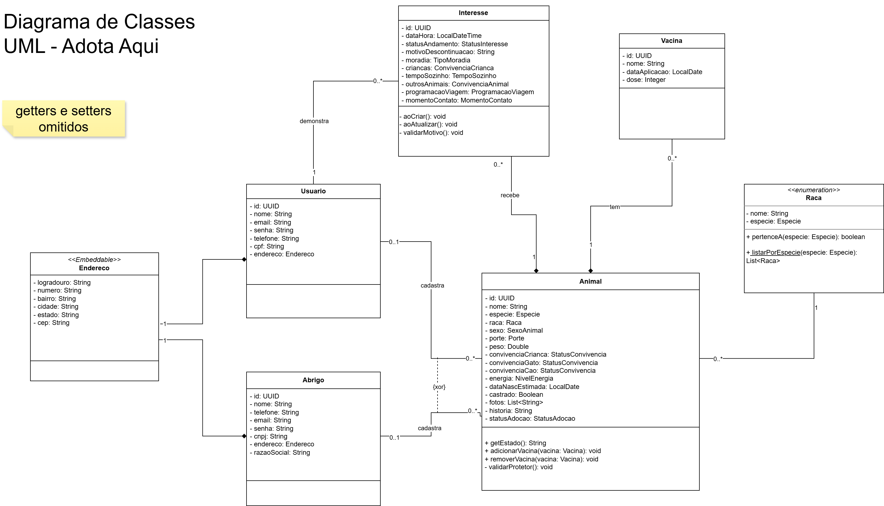

# Diagrama de classes com métodos

As classes do pacote `model` do back-end (as entidades que viram tabelas), com atributos, métodos e relacionamentos, do jeito que estão no código.

- Arquivo editável: `diagrama-de-classes-metodos.drawio` (abre no draw.io, app.diagrams.net).
- Pra entregar ou imprimir: `diagrama-de-classes-metodos.pdf` (duas páginas: as classes e as enumerações) e `diagrama-de-classes-metodos.png`, exportados do draw.io.
- O diagrama conceitual de setembro continua em `diagrama-de-classes-adota-aqui.pdf`.
- Os valores de cada enumeração estão no [dicionário de domínios](diagramas-adota-aqui.md#2-dicionário-de-domínios).

## Como ler

- `-` é privado e `+` é público. Método sublinhado é `static`.
- Getters e setters ficam de fora: só aparecem os métodos que têm alguma regra.
- **Composição** (losango cheio): a parte não existe sem o todo. Vacinas e interesses são apagados junto com o animal, e o endereço é guardado dentro da própria tabela de `usuario` e de `abrigo` (por isso o `<<Embeddable>>`).
- **Multiplicidade**: `0..1` é "nenhum ou um", `0..*` é "nenhum ou vários". Cada animal tem exatamente um protetor, Usuario **ou** Abrigo (é o `{xor}` entre as duas linhas "cadastra"), e o banco garante isso com um `CHECK`.

## O que cada método faz

| Classe | Método | O que faz |
| --- | --- | --- |
| Animal | `getEstado()` | Devolve o estado de quem cadastrou o animal. O animal não guarda estado próprio, e é esse valor que a vitrine compara com o estado de quem está logado (RF14) |
| Animal | `adicionarVacina()` e `removerVacina()` | Mexem na lista de vacinas já ligando ou desligando a vacina do animal |
| Animal | `validarProtetor()` | Roda antes de salvar e recusa animal sem protetor ou com os dois |
| Interesse | `aoCriar()` | Roda antes de salvar a primeira vez: preenche a data e hora e confere o motivo |
| Interesse | `aoAtualizar()` e `validarMotivo()` | Recusam um interesse Descontinuado sem motivo (RF10) |
| Raca | `pertenceA()` e `listarPorEspecie()` | Conferem se a raça é da espécie escolhida e listam as raças de uma espécie (`GET /api/racas`) |

## Diagrama

## Como atualizar

Mudou uma entidade do back (atributo novo, método com regra, relacionamento)? Abre o `.drawio`, atualiza a classe e exporta de novo o PNG e o PDF, tudo no mesmo PR.
