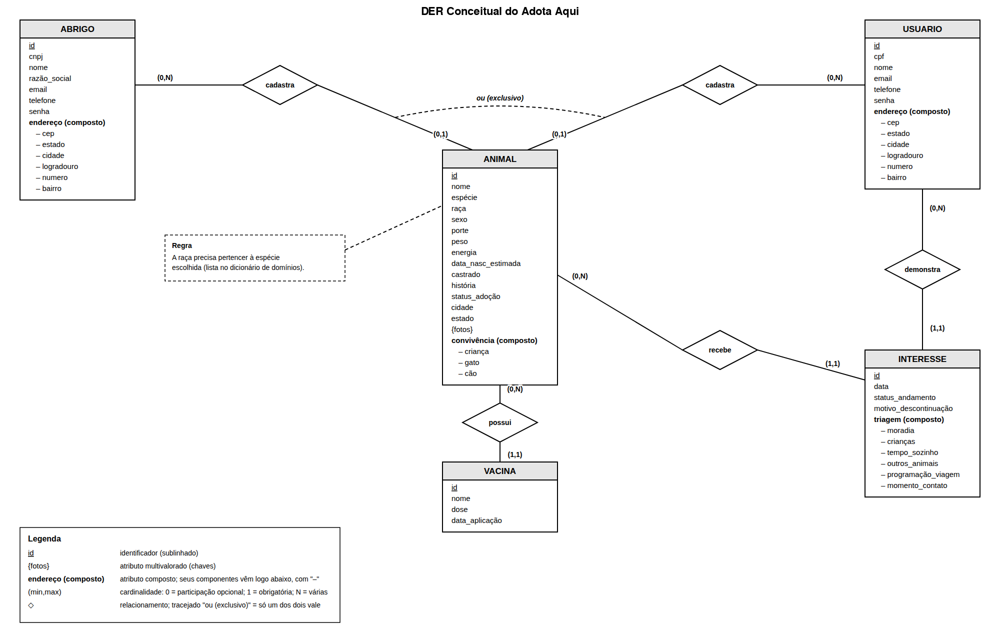
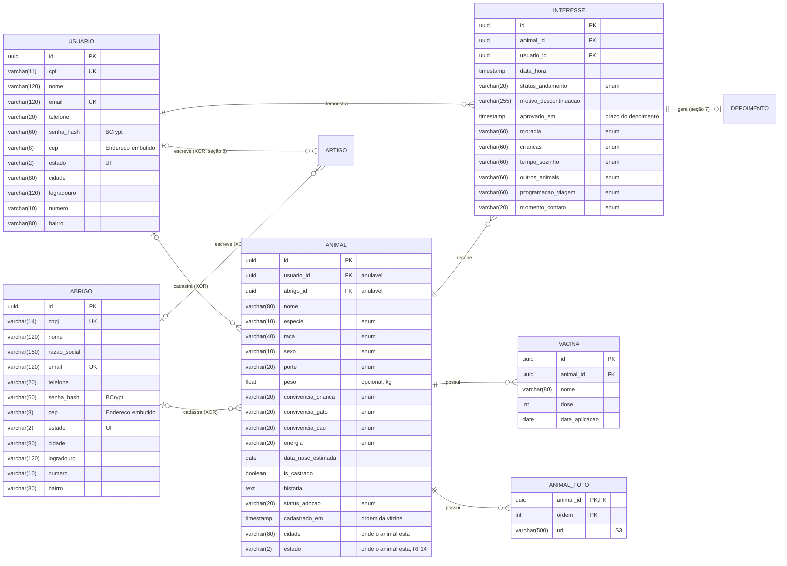
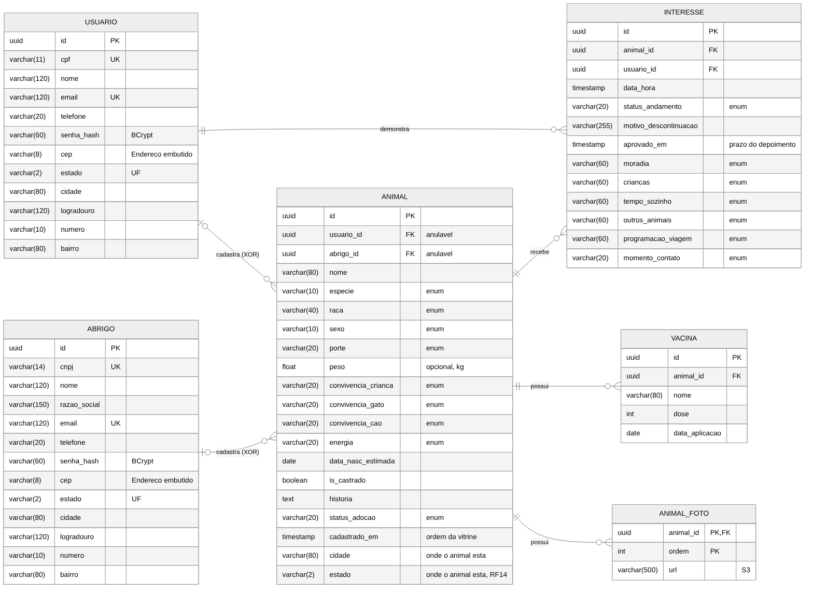
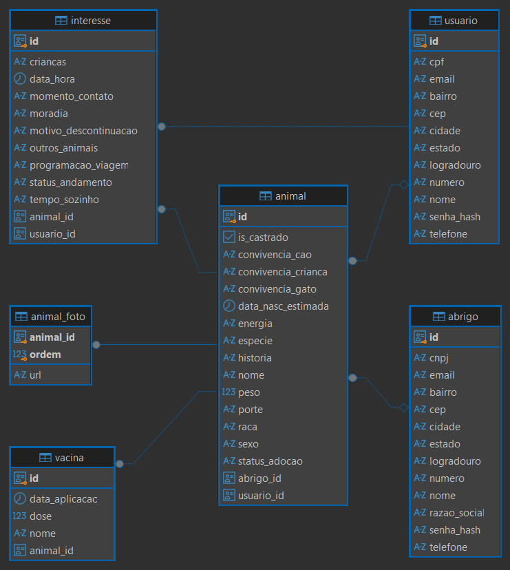
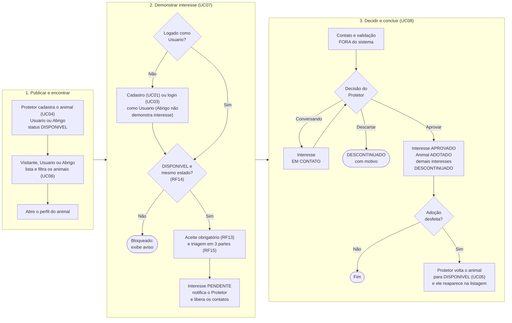
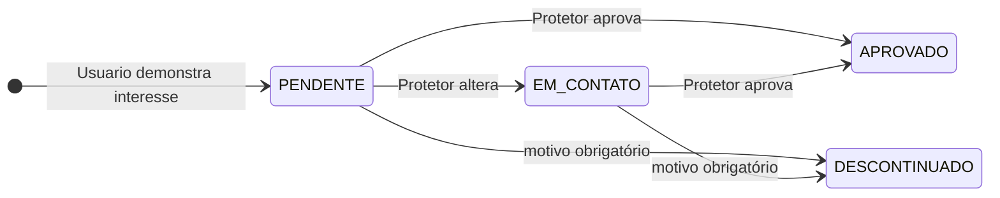
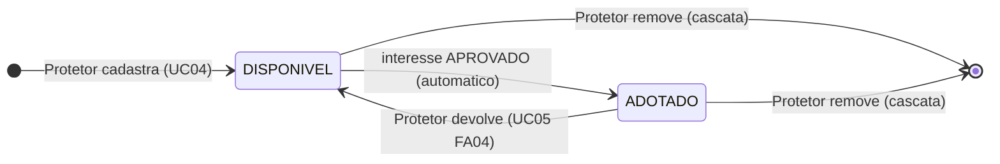
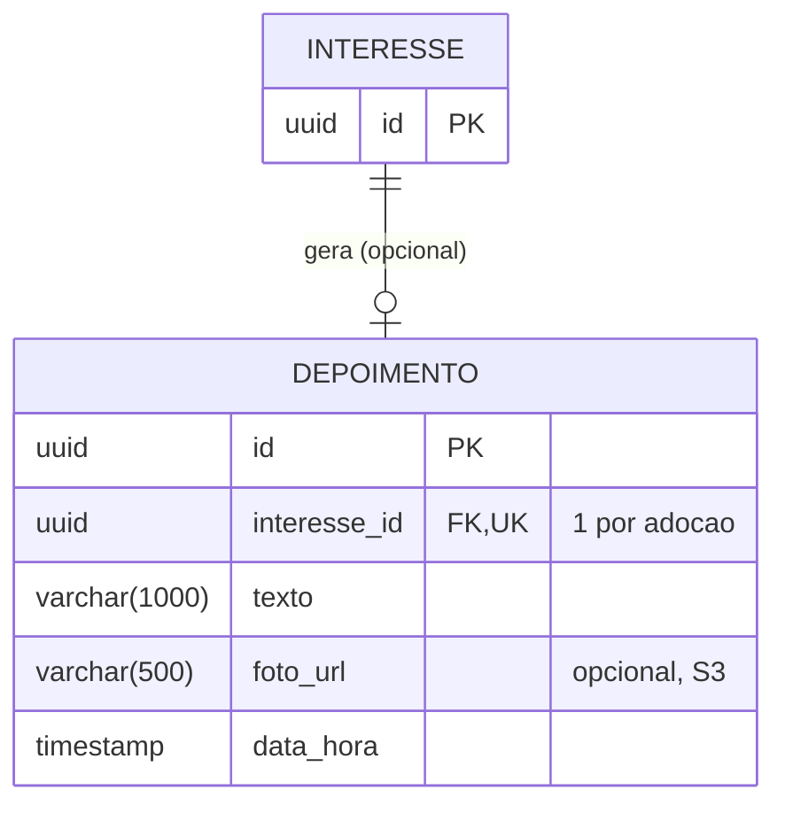
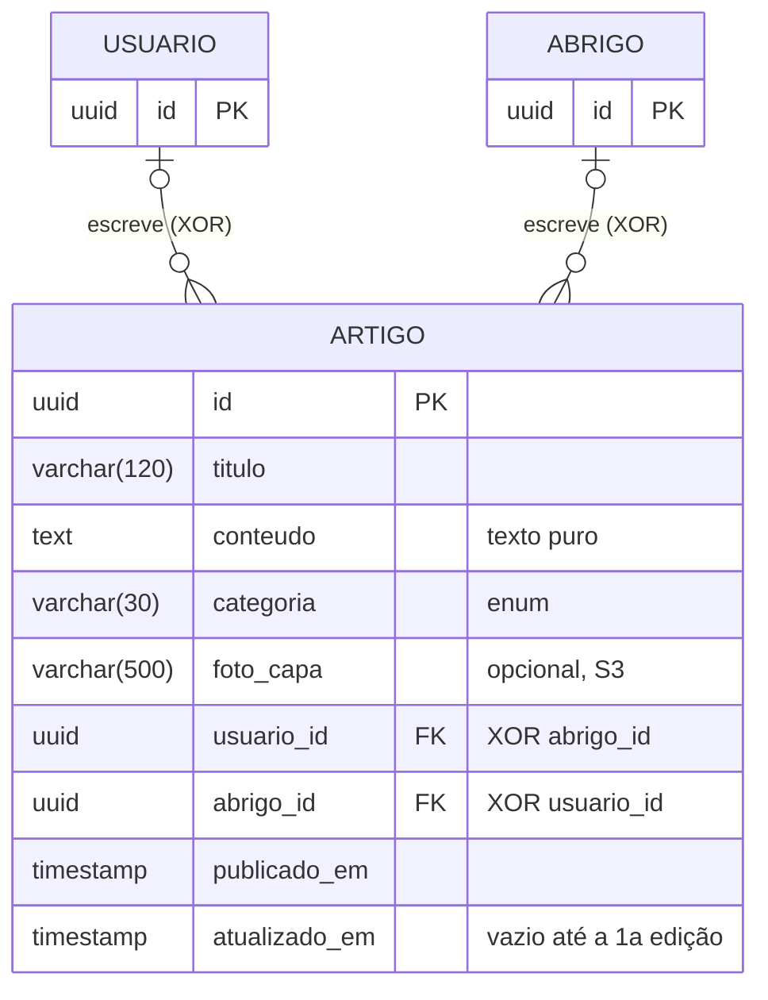
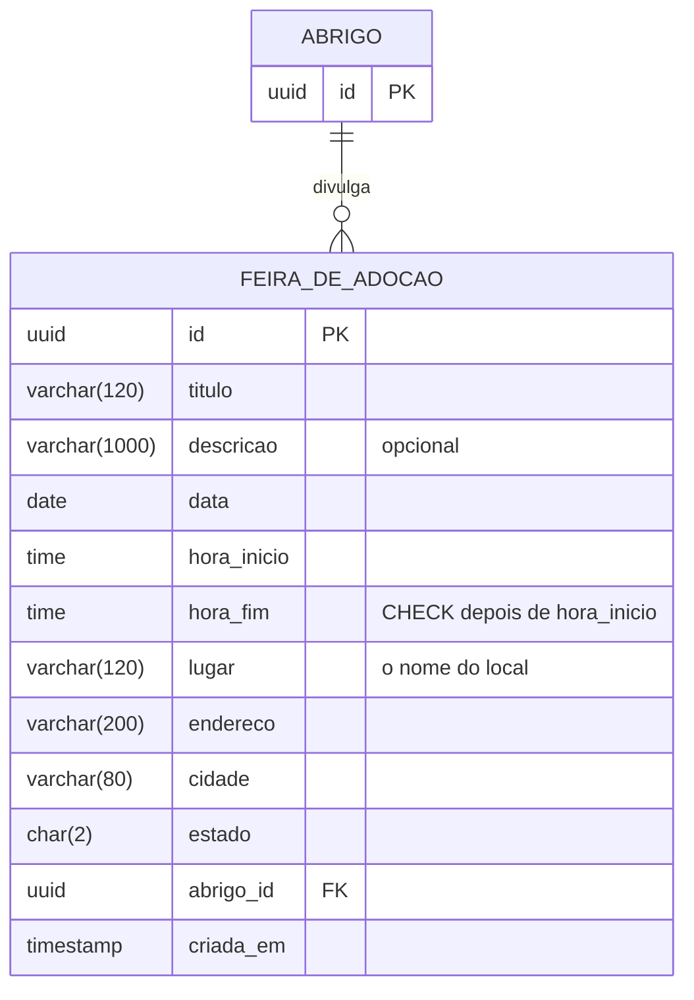

# Adota Aqui: DER conceitual e lógico, domínios, fluxo, estados e rotas

Os blocos `mermaid` abaixo são renderizados automaticamente pelo GitHub (em qualquer `.md` dentro de `docs/`). Também dá para colar o código em mermaid.live e exportar PNG/SVG.

O diagrama de classes com métodos fica num arquivo próprio: [diagrama-de-classes.md](diagrama-de-classes.md).

## 1. DER conceitual



Notação: cada entidade é um retângulo com seus atributos dentro, e cada relacionamento é um losango com a cardinalidade (mín,máx) de cada lado. A legenda está na própria imagem.

Decisões de modelagem:

- **Espécie e raça** são atributos de `Animal` com valores restritos (enums), porque ambos são filtros da listagem. A raça depende da espécie: no formulário, o usuário escolhe a espécie e só então aparecem as raças dela. O sistema valida que a raça pertence à espécie escolhida (a "Regra" no diagrama). Não há entidade `Raça` porque não existe tela para editar a lista de raças; se um dia existir, ela vira entidade.
- **Interesse** é a entidade associativa do N:M entre Usuario e Animal. Tem identidade e estados próprios.
- **Cadastrante do animal**: exatamente um, Usuario **ou** Abrigo (relacionamentos exclusivos, o arco tracejado).
- **Onde o animal está**: `cidade` e `estado` são atributos do próprio `Animal`, separados do endereço de quem cadastrou. O protetor pode se mudar, ou cadastrar um animal que está com outra pessoa, então o local do animal não pode depender da conta. É o estado do animal que vale pro RF14.
- **Atributos compostos**: `endereço` (em Usuario e Abrigo), `convivência` (criança, gato, cão) e `triagem` (as 6 respostas do UC07).
- **Multivalorado**: `{fotos}`. Só vira tabela (`animal_foto`) no modelo lógico.
- **Vacina** existe só dentro de um Animal (cardinalidade (1,1) do lado da Vacina).
- Listas fixas de opções (porte, sexo, energia, status, triagem) **não** são entidades: ficam como atributos, e os valores permitidos estão no dicionário de domínios (seção 2).

## 2. Dicionário de domínios

O dicionário de domínios é uma tabela que lista, para cada atributo com opções ou formato restrito, **quais valores ele aceita**. Ele complementa o diagrama: o diagrama mostra a estrutura (quem existe e como se liga), e o dicionário diz o que pode ser guardado em cada campo. Assim o diagrama fica limpo, e o front (opções do `<select>`), o back (enums) e os testes usam a mesma referência.

### Domínios enumerados

| Domínio            | Valores permitidos                                                                                                                                            | Onde é usado                            |
| ------------------ | ------------------------------------------------------------------------------------------------------------------------------------------------------------- | --------------------------------------- |
| Especie            | `CAO`, `GATO`                                                                                                                                                 | Animal.espécie                          |
| SexoAnimal         | `FEMEA`, `MACHO`                                                                                                                                              | Animal.sexo                             |
| Porte              | `PEQUENO`, `MEDIO`, `GRANDE`                                                                                                                                  | Animal.porte                            |
| StatusConvivencia  | `CONVIVE_BEM`, `NAO_CONVIVE_BEM`, `NAO_TESTADO`                                                                                                               | Animal.convivência (criança, gato, cão) |
| NivelEnergia       | `MAIS_ANIMADO`, `MAIS_CALMO`                                                                                                                                  | Animal.energia                          |
| StatusAdocao       | `DISPONIVEL`, `ADOTADO`                                                                                                                                       | Animal.status_adoção                    |
| StatusInteresse    | `PENDENTE`, `EM_CONTATO`, `APROVADO`, `DESCONTINUADO`                                                                                                         | Interesse.status_andamento              |
| TipoMoradia        | `CASA_COM_QUINTAL`, `CASA_SEM_QUINTAL`, `APARTAMENTO_TELADO`, `APARTAMENTO_NAO_TELADO`, `PREFIRO_RESPONDER_DIRETAMENTE_AO_PROTETOR`                           | triagem.moradia                         |
| ConvivenciaCrianca | `SIM`, `NAO`, `PREFIRO_RESPONDER_DIRETAMENTE_AO_PROTETOR`                                                                                                     | triagem.crianças                        |
| TempoSozinho       | `O_ANIMAL_NAO_FICARA_SOZINHO_EM_CASA`, `ATE_2_HORAS`, `ATE_4_HORAS`, `ATE_8_HORAS`, `MAIS_DE_8_HORAS`, `PREFIRO_RESPONDER_DIRETAMENTE_AO_PROTETOR`            | triagem.tempo_sozinho                   |
| ConvivenciaAnimal  | `NAO_TENHO_OUTROS_ANIMAIS_EM_CASA`, `SIM_GATOS`, `SIM_CACHORROS`, `SIM_GATOS_E_CACHORROS`, `SIM_OUTRAS_ESPECIES`, `PREFIRO_RESPONDER_DIRETAMENTE_AO_PROTETOR` | triagem.outros_animais                  |
| ProgramacaoViagem  | `LEVO_O_ANIMAL_COMIGO`, `DEIXO_NOS_CUIDADOS_DE_ALGUEM_DE_CONFIANCA`, `PREFIRO_RESPONDER_DIRETAMENTE_AO_PROTETOR`                                              | triagem.programação_viagem              |
| MomentoContato     | `MANHA`, `TARDE`, `NOITE`, `QUALQUER_HORARIO`                                                                                                                 | triagem.momento_contato                 |
| Raca               | lista por espécie (tabela abaixo); cada raça pertence a uma única espécie                                                                                     | Animal.raça                             |
| CategoriaArtigo      | `ADOCAO_RESPONSAVEL`, `PRIMEIROS_DIAS`, `SAUDE`, `COMPORTAMENTO`, `ALIMENTACAO`                                                                               | Artigo.categoria (seção 8)                |

### Raças por espécie

A raça é um enum no back-end, e cada valor carrega a sua espécie. O front busca as opções filtradas pela espécie escolhida (por exemplo `GET /api/racas?especie=CAO`), então a lista fica em um só lugar.

| Espécie | Raças                                                                                                                                                                                                                                                                                                              |
| ------- | ------------------------------------------------------------------------------------------------------------------------------------------------------------------------------------------------------------------------------------------------------------------------------------------------------------------ |
| CAO     | `SRD`, `LABRADOR`, `GOLDEN_RETRIEVER`, `PASTOR_ALEMAO`, `POODLE`, `SHIH_TZU`, `YORKSHIRE`, `PINSCHER`, `PIT_BULL`, `ROTTWEILER`, `BULLDOG`, `BEAGLE`, `BORDER_COLLIE`, `HUSKY_SIBERIANO`, `LHASA_APSO`, `MALTES`, `DACHSHUND`, `SPITZ_ALEMAO`, `BOXER`, `CHIHUAHUA`, `COCKER_SPANIEL`, `PUG`, `SCHNAUZER`, `OUTRA` |
| GATO    | `SRD`, `SIAMES`, `PERSA`, `ANGORA`, `MAINE_COON`, `RAGDOLL`, `BENGAL`, `SPHYNX`, `BRITISH_SHORTHAIR`, `ABISSINIO`, `BIRMANES`, `OUTRA`                                                                                                                                                                             |

`SRD` significa sem raça definida (vira-lata). `OUTRA` evita travar o cadastro de uma raça que não está na lista. Como `SRD` e `OUTRA` existem para as duas espécies, no código elas ficam como `SRD_CAO`, `SRD_GATO`, `OUTRA_CAO` e `OUTRA_GATO`.

### Regras de formato

| Atributo                   | Regra                                                   |
| -------------------------- | ------------------------------------------------------- |
| cpf                        | 11 dígitos numéricos, único                             |
| cnpj                       | 14 dígitos numéricos, único                             |
| email                      | formato de e-mail, único                                |
| telefone                   | DDD + número, só dígitos                                |
| senha                      | guardada como hash BCrypt, nunca em texto puro          |
| cep                        | 8 dígitos                                               |
| estado                     | UF com 2 letras maiúsculas (preenchida a partir do CEP) |
| cidade, logradouro, bairro | texto, preenchidos a partir do CEP                      |
| numero                     | texto curto (aceita "s/n" e complemento)                |
| fotos                      | uma ou mais URLs de imagem (S3); pelo menos 1 (RF16)    |
| peso                       | decimal em kg, maior que 0, opcional                    |
| data_nasc_estimada         | data, não pode ser futura                               |
| castrado                   | verdadeiro ou falso                                     |
| dose                       | inteiro, 1 ou mais                                      |
| data_aplicação             | data, não pode ser futura                               |
| motivo_descontinuação      | texto, obrigatório quando o status é `DESCONTINUADO`    |

## 3. DER lógico

Os tipos são os que o Hibernate cria no PostgreSQL a partir das entidades. Convenções: chaves primárias em UUID; `Endereco` é `@Embeddable`, então suas colunas ficam dentro de `usuario` e `abrigo`; enums gravados como texto (`@Enumerated(EnumType.STRING)`); `estado` guardado como UF de 2 letras (vem do CEP).





A imagem acima é o bloco de cima exportado com o tema `neutral` do Mermaid (`mmdc -t neutral -s 2`), sem `depoimento` e `artigo`, que têm diagrama próprio nas seções 7 e 8.

O banco de verdade, criado pelo Hibernate e visto num cliente de banco de dados:



Esse print é de outubro, de antes do depoimento, do blog, do `cadastrado_em`, do `aprovado_em` e do local do animal (`cidade` e `estado` em `animal`). Pra atualizar, abra o banco no DBeaver depois do deploy, gere o diagrama das tabelas e troque o `der-fisico.png`.

### Regras de integridade

| Tabela           | Regra                                                                         | Como garantir                                                                                                                                   |
| ---------------- | ----------------------------------------------------------------------------- | ----------------------------------------------------------------------------------------------------------------------------------------------- |
| usuario          | `cpf` e `email` únicos                                                        | `unique = true` na entidade                                                                                                                     |
| abrigo           | `cnpj` e `email` únicos                                                       | `unique = true` na entidade                                                                                                                     |
| usuario e abrigo | e-mail único também entre as duas tabelas                                     | Service (`existsByEmail` nos dois repositories)                                                                                                 |
| animal           | a `raca` deve pertencer à `especie` informada                                 | Service (`raca.pertenceA(especie)`), retornando 400 se não bater                                                                                |
| animal           | exatamente um dono: `usuario_id` OU `abrigo_id` (XOR)                         | `CHECK ((usuario_id IS NOT NULL AND abrigo_id IS NULL) OR (usuario_id IS NULL AND abrigo_id IS NOT NULL))` via `@Check` + validação na entidade |
| animal           | `peso`, quando vem, maior que zero                                            | `CHECK (peso IS NULL OR peso > 0)` via `@Check` + validação do DTO                                                                              |
| animal           | remover o animal remove fotos, vacinas e interesses (UC05)                    | `cascade = ALL` + `orphanRemoval = true`                                                                                                        |
| animal           | dono (usuario/abrigo) não é apagado no MVP                                    | FK sem cascade: o banco recusa apagar uma conta que ainda tem animal                                                                            |
| animal           | `cidade` e `estado` sempre preenchidos (onde o animal está)                   | Java: sem local no cadastro, vale o endereço do protetor (`@PrePersist`); os antigos o `LocalDosAnimaisAntigos` preenche quando o back sobe. Sem `NOT NULL` no banco porque o Hibernate não cria coluna obrigatória numa tabela que já tem linhas |
| animal_foto      | PK composta (`animal_id`, `ordem`); a primeira foto é a capa                  | `@ElementCollection` + `@OrderColumn`                                                                                                           |
| vacina           | `dose`, quando vem, 1 ou mais                                                 | `CHECK (dose IS NULL OR dose >= 1)` via `@Check` + validação do DTO                                                                             |
| todas            | colunas de enum só aceitam os valores do dicionário                           | `CHECK` que o Hibernate cria pra cada coluna `@Enumerated`                                                                                      |
| interesse        | `motivo_descontinuacao` obrigatório quando `status_andamento = DESCONTINUADO` | `CHECK (status_andamento <> 'DESCONTINUADO' OR motivo_descontinuacao IS NOT NULL)` + Service                                                    |
| interesse        | um Usuario só pode ter 1 interesse ATIVO (PENDENTE ou EM CONTATO) por animal  | Service (`existsBy...StatusIn`), com o animal travado                                                                                           |
| interesse        | só 1 interesse APROVADO por animal                                            | Service, dentro da mesma transação que muda o animal para ADOTADO                                                                               |
| interesse        | Usuario não demonstra interesse em animal que ele mesmo cadastrou             | Service (`animal.usuario_id <> interesse.usuario_id`)                                                                                           |

Índices (o PostgreSQL não cria índice automático em FK): `animal(status_adocao)`, `animal(usuario_id)`, `animal(abrigo_id)`, `interesse(usuario_id, animal_id)`, `interesse(animal_id, status_andamento)` e `vacina(animal_id)`. Estão nas entidades, e a medição de cada um está na [arquitetura](../arquitetura.md#índices).

Consulta da listagem (RF07 e RF14). O estado que vale é o do animal (onde ele está), guardado na própria tabela `animal`. O filtro por estado só entra para Usuario logado; para Visitante e Abrigo a mesma consulta roda sem essa linha (todos os estados). Os demais filtros (porte, sexo, convivência, energia, cidade e a busca por nome do animal ou do protetor) entram do mesmo jeito, como condições opcionais. No código, quem monta essa consulta é o `AnimalSpecifications`:

```sql
SELECT a.*, COALESCE(u.nome, b.nome) AS protetor
FROM animal a
LEFT JOIN usuario u ON u.id = a.usuario_id
LEFT JOIN abrigo  b ON b.id = a.abrigo_id
WHERE a.status_adocao = 'DISPONIVEL'
  AND a.estado = :estado                              -- só para Usuario logado
  AND (:especie IS NULL OR a.especie = :especie)
  AND (:raca    IS NULL OR a.raca    = :raca);
```

## 4. Diagrama de fluxo



## 5. Máquinas de estado

Interesse (quando o Candidato clica em "Desistir da adoção", o registro é excluído, por isso não há estado final para isso):



Animal:



## 6. Tabela de rotas (React Router)

Níveis de acesso: **Pública** (Visitante), **Autenticada** (Usuario ou Abrigo), **Somente Usuario**. O front esconde e redireciona; quem realmente impede o acesso é a API (JWT com perfil + checagem de dono do animal, RNF03), que responde 401/403.

| Rota                       | Tela                                                                                                                                                                                                                | Acesso                             | Casos de uso / requisitos |
| -------------------------- | ------------------------------------------------------------------------------------------------------------------------------------------------------------------------------------------------------------------- | ---------------------------------- | ------------------------- |
| `/`                        | Home: apresentação, números do site, vitrine, histórias de adoção, "Como funciona a adoção" e a chamada "Conheça o Adota Aqui"                                                                                     | Pública                            | UC06                      |
| `/animais`                 | Listagem com busca por nome do animal ou do protetor e filtros (espécie, raça, porte, sexo, convivência, energia, cidade). Visitante e Abrigo veem todos os estados; só o Usuario logado vê apenas o próprio estado. Com `?busca=`, abre já buscando por esse nome | Pública                            | UC06, RF07, RF14          |
| `/animais/:id`             | Perfil completo do animal. Botão "Quero conhecer {nome}" só para Usuario do mesmo estado (Abrigo não vê o botão); vira "Desistir da adoção" se já houver interesse                                                  | Pública                            | UC06, UC07                |
| `/animais/:id/interesse`   | Aviso de guarda responsável (aceite obrigatório) e triagem em 3 partes                                                                                                                                              | Somente Usuario                    | UC07, RF13, RF15          |
| `/login`                   | Login com CPF ou CNPJ e senha                                                                                                                                                                                       | Pública (redireciona se já logado) | UC03, RF03                |
| `/cadastro`                | Escolha do tipo de conta                                                                                                                                                                                            | Pública                            | UC01, UC02                |
| `/cadastro/usuario`        | Cadastro de pessoa física                                                                                                                                                                                           | Pública                            | UC01, RF01                |
| `/cadastro/abrigo`         | Cadastro de ONG/abrigo                                                                                                                                                                                              | Pública                            | UC02, RF02                |
| `/meus-animais`            | Animais que eu cadastrei (editar/remover)                                                                                                                                                                           | Autenticada                        | UC05                      |
| `/meus-animais/novo`       | Cadastrar animal (dados, fotos, vacinas)                                                                                                                                                                            | Autenticada                        | UC04, RF04, RF05, RF16    |
| `/meus-animais/:id/editar` | Editar ou remover. Se ADOTADO, só o status é editável                                                                                                                                                               | Autenticada + dono do animal       | UC05, RF06                |
| `/interesses-recebidos`    | Painel dos interesses nos meus animais: contatos, status, aprovar/descontinuar                                                                                                                                      | Autenticada (Protetor)             | UC08, RF09, RF10          |
| `/perfil`                  | Meu perfil: editar os dados e o endereço, trocar a senha e sair da conta. CPF e CNPJ não mudam                                                                                                                      | Autenticada                        | UC10, RF17                |
| `/meus-interesses`         | Minhas candidaturas: interesses que eu demonstrei, com status, contato do protetor e o motivo da descontinuação. Dá pra desistir dos que estão em andamento                                                         | Somente Usuario                    | UC07, RF09                |
| `/meus-interesses/:id/depoimento` | Contar como foi a adoção: texto, foto opcional e autorização pra publicar no mural | Somente Usuario | UC09, RF11 |
| `/historias`               | Mural de histórias de adoção | Pública | RF11 |
| `/blog`                   | Blog para tutores, com os filtros por assunto e o "Escrever um artigo" pra quem é protetor | Pública | ERS 6.4 |
| `/blog/:id`               | Um artigo inteiro. Quem escreveu vê "Editar artigo" e "Apagar artigo" | Pública | ERS 6.4 |
| `/blog/novo` e `/blog/:id/editar` | Escrever e editar um artigo: título, assunto, capa opcional e texto | Autenticada (protetor; editar só o autor) | ERS 6.4 |
| `/protetores`             | Abrigos e protetores independentes, em ordem alfabética, com filtro por tipo, estado, cidade e nome, e o "Ver animais" de cada um | Pública | RF07, ERS 4 |
| `/quem-somos`             | Como o projeto surgiu, a ideia, a motivação e o que ele se propõe a fazer | Pública | - |
| `/clinicas`               | Mapa das clínicas veterinárias perto da localização, da cidade digitada, da cidade do animal (`?cidade=&estado=`) ou da cidade do perfil | Pública | ERS 6.10 |
| `/me-ajuda-a-escolher`    | A pessoa conta a rotina e a IA sugere até 3 animais disponíveis do site, com o motivo. Pessoa física logada recebe do estado do perfil | Pública | ERS 6.12 |
| `/observatorio`           | Observatório da adoção: o mapa do Brasil em mosaico com os números do site por estado (da API) e a porcentagem dos lares com cachorro e gato (IBGE), o ranking, a tabela e números públicos com fonte | Pública | ERS 6.8 |
| `/feiras`                 | Feiras de adoção que ainda vão acontecer, com filtro por estado e cidade. O abrigo vê "Divulgar uma feira" e, nas dele, "Editar" e "Apagar" | Pública | - |
| `/feiras/nova` e `/feiras/:id/editar` | Divulgar e editar uma feira: título, data, horário, local, endereço, cidade, estado e descrição | Somente Abrigo (editar só o que divulgou) | - |
| `*`                        | Página não encontrada                                                                                                                                                                                               | Pública                            | -                         |

No React, isso vira três tipos de rota: as públicas soltas, a `RotaProtegida` sem restrição de perfil (`/meus-animais/*`, `/interesses-recebidos` e `/perfil`) e a `RotaProtegida apenasUsuario` (`/animais/:id/interesse` e `/meus-interesses`). O depoimento (seção 7) ficou na `/meus-interesses/:id/depoimento`, também só de pessoa física, e o mural `/historias` é público. O blog para tutores (seção 8) é público pra ler, e escrever e editar ficam na `RotaProtegida` sem restrição de perfil. A página de abrigos e protetores, o Quem somos e o mapa de clínicas são públicos. As feiras são públicas pra ver, e divulgar e editar ficam na `RotaProtegida apenasAbrigo`, que manda quem não é abrigo de volta pra `/feiras`.

## 7. Depoimento (UC09, RF11)

Era uma extensão opcional e entrou depois do MVP, do jeito que estava planejado aqui: uma tabela nova ligada ao `interesse` (que já liga Usuario e Animal). A única mudança nas tabelas existentes foi a coluna `aprovado_em` no `interesse`, que conta o prazo de 30 dias pra contar como foi (ERS 6.3).



Regras: só quem tem o interesse APROVADO pode registrar, e só na adoção atual do animal (o service confere o status, o dono do interesse, o animal Adotado e o prazo); o texto é obrigatório e a foto é opcional; e a remoção do animal continua em cascata (apagar o animal apaga os interesses, e o banco apaga o depoimento junto, com `on delete cascade`). As telas são a `/meus-interesses/:id/depoimento` e o mural `/historias` (ver [funcionalidades](../funcionalidades.md#12-histórias-de-adoção-depoimentos)).

## 8. Blog para tutores (ERS 6.4)

Também entrou depois do MVP. É uma tabela nova, sem mudar as que já existiam. O autor segue a mesma regra do animal: um Usuario **ou** um Abrigo, nunca os dois, com um `CHECK` no banco.



Regras: escreve quem é protetor (um Abrigo, ou um Usuario com pelo menos um animal cadastrado), e só o autor edita e apaga (o service confere as duas coisas); título de 5 a 120 caracteres e texto de 50 a 10000; a capa tem que ter vindo do `POST /api/fotos` e sai do S3 quando é trocada ou quando o artigo é apagado. As telas são a `/blog`, a `/blog/:id` e o formulário (ver [funcionalidades](../funcionalidades.md#13-blog-para-tutores)).

## 9. Feiras de adoção

Entrou depois do MVP, na semana da apresentação. É uma tabela nova, sem mudar as que já existiam. Só abrigo divulga feira, então a ligação é só com o `ABRIGO`.



Regras: só abrigo divulga, e só o abrigo que divulgou edita e apaga (o service confere); a data não pode ter passado e o horário de fim vem depois do de início (o service confere, e o banco tem o `CHECK` do horário); a lista pública mostra só as feiras de hoje em diante, da mais próxima pra mais distante. A tela é a `/feiras` (ver [funcionalidades](../funcionalidades.md#17-feiras-de-adoção)).
