# Funcionalidades implementadas

O que já funciona no Adota Aqui: o que cada funcionalidade faz, como ela funciona por dentro (tela, API e banco), as regras que ela segue e onde ficam o código e os testes.

Situação em 24/10/2026, fim da Sprint 5. A regra é a mesma do resto da pasta: entrou funcionalidade nova, entra uma seção nova aqui, no mesmo PR. O porquê das principais regras (login por documento, ids UUID, remoção em cascata, aprovação travada) está em [aspectos relevantes](aspectos-relevantes.md).

Os prints foram tirados com os dados de exemplo do projeto (`frontend/src/mocks`), por isso os animais aparecem sem foto. No site, as fotos vêm do Amazon S3.

## Sumário

1. [Cadastro de conta](#1-cadastro-de-conta)
2. [Login, sessão e saída](#2-login-sessão-e-saída)
3. [Controle de acesso](#3-controle-de-acesso)
4. [Página inicial e vitrine de animais](#4-página-inicial-e-vitrine-de-animais)
5. [Perfil do animal](#5-perfil-do-animal)
6. [Cadastro, edição e remoção de animal (CRUD)](#6-cadastro-edição-e-remoção-de-animal-crud)
7. [Demonstrar interesse e desistir](#7-demonstrar-interesse-e-desistir)
8. [Painel de interesses recebidos](#8-painel-de-interesses-recebidos)
9. [Minhas candidaturas](#9-minhas-candidaturas)
10. [Meu perfil](#10-meu-perfil)
11. [O que vale pro sistema todo](#11-o-que-vale-pro-sistema-todo)
12. [Histórias de adoção (depoimentos)](#12-histórias-de-adoção-depoimentos)
13. [Blog para tutores](#13-blog-para-tutores)
14. [Abrigos e protetores](#14-abrigos-e-protetores)
15. [Quem somos](#15-quem-somos)
16. [Clínicas veterinárias perto de você](#16-clínicas-veterinárias-perto-de-você)
17. [Feiras de adoção](#17-feiras-de-adoção)
18. [Observatório da adoção](#18-observatório-da-adoção)
19. [O que ainda não está pronto](#19-o-que-ainda-não-está-pronto)

## Quem usa o sistema

| Perfil    | Como entra                    | O que pode fazer                                                                                                                                                            |
| --------- | ----------------------------- | --------------------------------------------------------------------------------------------------------------------------------------------------------------------------- |
| Visitante | Sem login                     | Ver a vitrine (animais de todos os estados) e o perfil de cada animal                                                                                                       |
| Usuario   | Pessoa física, login com CPF  | Ver os animais do próprio estado, demonstrar interesse, acompanhar as candidaturas e desistir. Também pode cadastrar animais que resgatou e cuidar dos interesses recebidos |
| Abrigo    | ONG ou abrigo, login com CNPJ | Ver a vitrine de todos os estados, cadastrar animais e cuidar dos interesses recebidos. Divulga feiras de adoção. Não demonstra interesse                                    |

**Protetor** é quem cadastrou o animal, seja Usuario ou Abrigo. No blog para tutores, escreve o Abrigo ou a pessoa que já cadastrou pelo menos um animal.

## Resumo

| #   | Funcionalidade                      | Requisitos                   | Telas                                                             | Endpoints                                                                                                            |
| --- | ----------------------------------- | ---------------------------- | ----------------------------------------------------------------- | -------------------------------------------------------------------------------------------------------------------- |
| 1   | Cadastro de conta                   | RF01, RF02, RNF02            | `/cadastro`, `/cadastro/usuario`, `/cadastro/abrigo`              | `POST /api/usuarios`, `POST /api/abrigos`                                                                            |
| 2   | Login, sessão e saída               | RF03, RNF03                  | `/login`, `/perfil`                                               | `POST /api/auth/login`                                                                                               |
| 3   | Controle de acesso                  | RNF03, RF14                  | Todas                                                             | Todos                                                                                                                |
| 4   | Página inicial e vitrine de animais | RF07, RF14, ERS 6.7                | `/`, `/animais`                                                   | `GET /api/animais`, `GET /api/racas`, `GET /api/estatisticas`                                                        |
| 5   | Perfil do animal                    | RF07, RF14                   | `/animais/:id`                                                    | `GET /api/animais/{id}`                                                                                              |
| 6   | CRUD de animal e fotos              | RF04, RF05, RF06, RF16       | `/meus-animais`, `/meus-animais/novo`, `/meus-animais/:id/editar` | `GET /api/animais/meus`, `POST /api/animais`, `PUT /api/animais/{id}`, `DELETE /api/animais/{id}`, `POST /api/fotos` |
| 7   | Demonstrar interesse e desistir     | RF08, RF09, RF13, RF14, RF15 | `/animais/:id/interesse`                                          | `POST /api/animais/{id}/interesses`, `DELETE /api/interesses/{id}`                                                   |
| 8   | Painel de interesses recebidos      | RF09, RF10, RF12             | `/interesses-recebidos`                                           | `GET /api/interesses/recebidos`, `PATCH /api/interesses/{id}/status`                                                 |
| 9   | Minhas candidaturas                 | RF09, UC07                   | `/meus-interesses`                                                | `GET /api/interesses/meus`, `DELETE /api/interesses/{id}`                                                            |
| 10  | Meu perfil                          | RF17, RF14, UC10             | `/perfil`                                                         | `GET` e `PUT` em `/api/usuarios/me` e `/api/abrigos/me`, `PATCH` em `.../me/senha`                                   |
| 11  | Histórias de adoção | RF11, UC09 | `/historias`, `/meus-interesses/:id/depoimento` | `POST /api/interesses/{id}/depoimento`, `GET /api/depoimentos`, `DELETE /api/depoimentos/{id}` |
| 12  | Blog para tutores | ERS 6.4 | `/blog`, `/blog/:id`, `/blog/novo`, `/blog/:id/editar` | `GET`, `POST`, `PUT` e `DELETE` em `/api/artigos`, `GET /api/artigos/meus` |
| 13  | Abrigos e protetores | RF07, ERS 4 | `/protetores` | `GET /api/protetores` |
| 14  | Quem somos | Fora da ERS | `/quem-somos` e a chamada no fim da Home | Nenhum |
| 15  | Clínicas veterinárias | ERS 6.10 | `/clinicas` e o link no perfil do animal | Nenhum (o mapa é do Google) |
| 16  | Feiras de adoção | Depois do MVP | `/feiras`, `/feiras/nova`, `/feiras/:id/editar` e a seção na Home | `GET`, `POST`, `PUT` e `DELETE` em `/api/feiras`, `GET /api/feiras/minhas` |
| 17  | Observatório da adoção | ERS 6.8 | `/observatorio` | `GET /api/estatisticas/estados` |

Os detalhes de cada endpoint (entrada, saída e erros) estão no [contrato da API](api.md).

---

## 1. Cadastro de conta

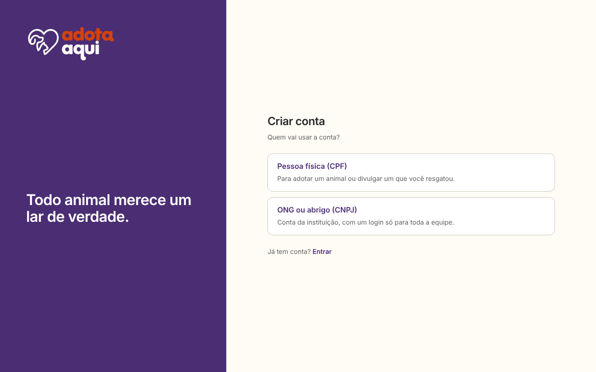

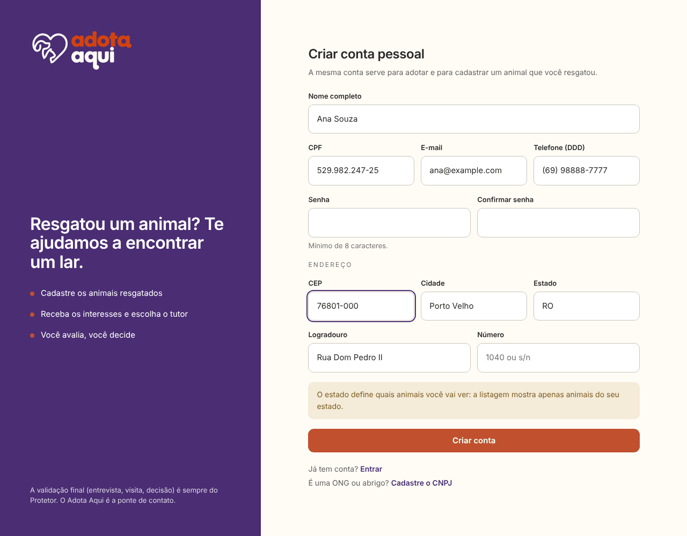

**O que faz.** Cria a conta de uma pessoa física (Usuario, com CPF) ou de uma ONG ou abrigo (Abrigo, com CNPJ). A mesma conta de pessoa física serve pra adotar e pra divulgar um animal que a pessoa resgatou.

**Como funciona.**

1. Em `/cadastro`, a pessoa escolhe "Pessoa física (CPF)" ou "ONG ou abrigo (CNPJ)".
2. Preenche o formulário:
   - Pessoa física: nome completo, CPF, e-mail e telefone.
   - Abrigo: CNPJ, nome institucional, razão social, e-mail institucional e telefone.
   - Os dois: senha, confirmação da senha e endereço.
3. Ao digitar os 8 números do CEP, o front consulta o ViaCEP e preenche logradouro, bairro, cidade e estado. Os campos continuam editáveis. Se o CEP não existir, aparece "CEP não encontrado. Confira os números.".
4. O front confere tudo antes de enviar e manda só os números de CPF, CNPJ, telefone e CEP.
5. O back confere de novo, guarda a senha criptografada com BCrypt e responde `201` já com o token de login. A pessoa entra direto, sem precisar fazer login, e vai pra vitrine.

**Regras e validações.**

- CPF e CNPJ têm os dígitos verificadores conferidos no front e no back, com o mesmo cálculo. Números repetidos, como 111.111.111-11, são recusados. Erro do back: `400` "CPF inválido" ou "CNPJ inválido".
- Senha de 8 a 72 caracteres, e a confirmação precisa ser igual ("As senhas não conferem.").
- Telefone com DDD: 10 ou 11 números. CEP: 8 números. Estado: sigla de 2 letras. Número do endereço obrigatório.
- Documento que já tem conta: `409` "Já existe uma conta cadastrada com este CPF" (ou CNPJ).
- E-mail que já tem conta, olhando as duas tabelas (uma pessoa e um abrigo não podem usar o mesmo e-mail): `409` "Já existe uma conta cadastrada com este e-mail". O e-mail é guardado em minúsculas.
- Os erros aparecem embaixo do campo certo, e o foco vai pro primeiro campo com erro.
- A pessoa física vê o aviso de que o estado do endereço define quais animais ela vai ver (RF14).

**Como fica no banco.** Tabelas `usuario` e `abrigo`, com id UUID, documento único (`cpf` com 11 caracteres, `cnpj` com 14), e-mail único e `senha_hash`, que guarda o resultado do BCrypt e nunca a senha. O endereço (CEP, estado, cidade, logradouro, número e bairro) fica em colunas da própria tabela.

**Onde está no código.**

- Front: `pages/EscolhaCadastro`, `pages/CadastroUsuario`, `pages/CadastroAbrigo`, `components/FormularioCadastro`, `components/CamposEndereco`, `services/viacep.js`, `utils/validacoes.js` e `utils/mascaras.js`
- Back: `AuthController`, `CadastroService`, `CadastroUsuarioRequest`, `CadastroAbrigoRequest`, `EnderecoDto` e `SecurityConfig` (BCrypt)

**Testes.** `AutenticacaoIntegrationTest` (cadastro dos dois tipos, documento e e-mail repetidos, dígito verificador errado, confirmação de senha), `DtoValidationTest`, `Cadastro.test.jsx` (CEP, senhas diferentes, erro 409 no campo certo) e `Validacoes.test.jsx` (máscaras, CPF e CNPJ).

---

## 2. Login, sessão e saída

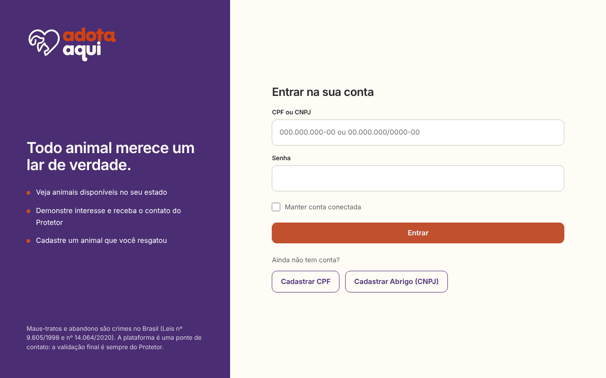

**O que faz.** Entra na conta com CPF ou CNPJ e senha. O sistema descobre o tipo de conta pela quantidade de números: 11 é CPF e 14 é CNPJ (RF03).

**Como funciona.**

1. O campo "CPF ou CNPJ" usa a máscara de CPF até o 11º número e troca pra de CNPJ depois disso.
2. O back procura a conta na tabela certa e compara a senha com o `senha_hash` usando o BCrypt.
3. Deu certo: o back devolve um token JWT válido por 24 horas, junto com o tipo de conta, o id e o nome.
4. O front guarda essa sessão. Com "Manter conta conectada" marcado, ela fica no `localStorage` e continua lá depois de fechar o navegador. Sem marcar, fica no `sessionStorage` e some quando a aba fecha.
5. Toda chamada que precisa de login manda o token no cabeçalho `Authorization: Bearer ...`.
6. Quando o token vence, o front sai da conta sozinho. Se a API responder `401` no meio do uso, o front também sai.
7. Depois do login, a pessoa volta pra página que tentou abrir, ou vai pra vitrine.
8. Pra sair: avatar com as iniciais, no topo, e depois "Sair da conta".

**Regras.**

- Senha errada e conta que não existe dão a mesma resposta: `401` "Documento ou senha inválidos". Assim ninguém descobre quais CPFs têm conta.
- Documento que não tem 11 nem 14 números: `400`.
- O token guarda só o id da conta e o tipo (USUARIO ou ABRIGO). CPF e CNPJ não vão no token.

**Onde está no código.**

- Front: `pages/Login`, `contexts/AuthContext.jsx`, `services/autenticacao.js`, `components/Navbar` e `pages/Perfil`
- Back: `AuthController`, `AutenticacaoService`, `JwtService`, `JwtAuthenticationFilter` e `SecurityConfig`

**Testes.** `AutenticacaoIntegrationTest` (mesma mensagem pros dois erros, token inválido ou vencido, token sem documento), `Login.test.jsx`, `AuthContext.test.jsx` e `Navbar.test.jsx`.

---

## 3. Controle de acesso

**O que faz.** Garante que cada perfil só faça o que pode, na tela e na API. Quem manda é a API: o front só esconde o que não faz sentido mostrar.

**No front.**

- As rotas que precisam de login (`/meus-animais`, cadastro e edição de animal, `/interesses-recebidos`, `/perfil` e escrever ou editar um artigo) passam pela `RotaProtegida`. Sem login, a pessoa vai pro `/login` e volta pra mesma página depois de entrar.
- Demonstrar interesse e Minhas candidaturas são só pra pessoa física. Abrigo que tenta abrir essas páginas vai pra página inicial.
- O menu muda conforme quem está logado. Visitante vê "Cadastrar" e "Entrar". Quem está logado vê "Explorar", "Meus animais", "Interesses recebidos" e, só pessoa física, "Minhas candidaturas".

**Na API.**

- Públicos: login, os dois cadastros, a vitrine, o perfil do animal, a lista de raças, os números do site, o mural de histórias e a leitura dos artigos. O resto exige token.
- Sem token: `401` "Autenticação necessária". Token inválido ou vencido: `401` "Token inválido ou expirado".
- O papel (`ROLE_USUARIO` ou `ROLE_ABRIGO`) vem do token. Antes de editar, remover ou mudar um status, o service confere se a conta é a dona do animal. Quem não é recebe `403`.
- CORS: a API só aceita chamadas dos endereços configurados em `CORS_ORIGENS` (o site e os deploy previews do Netlify).

**Onde está no código.** `routes/RotaProtegida.jsx` e `routes/AppRoutes.jsx` no front. `SecurityConfig`, `JwtAuthenticationFilter` e `ErroSegurancaHandler` no back.

**Testes.** `AuthContext.test.jsx` (redireciona pro login, bloqueia abrigo), `App.test.jsx`, `AutenticacaoIntegrationTest` (CORS e token) e os testes de dono em `AnimalIntegrationTest` e `InteresseIntegrationTest`.

---

## 4. Página inicial e vitrine de animais

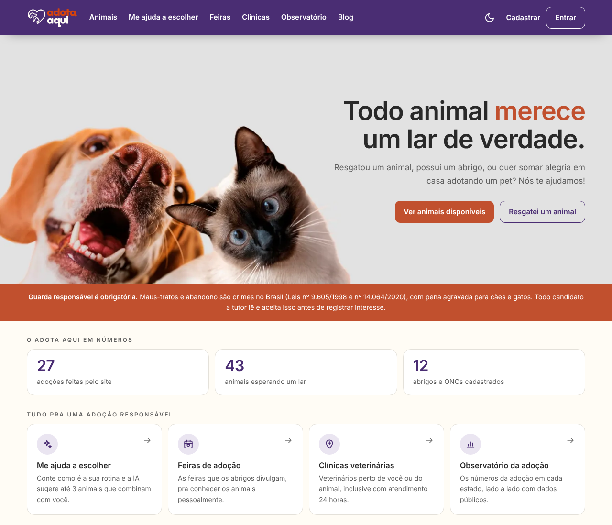

**Página inicial.** Abre com a apresentação do Figma: a foto de um cão e um gato, o título "Todo animal merece um lar de verdade." e os botões "Ver animais disponíveis" e "Resgatei um animal". No celular e no tablet, a foto fica escurecida e o texto branco; no computador com o tema claro, a foto aparece inteira e o texto fica escuro. Logo abaixo vem a faixa laranja da guarda responsável (Leis nº 9.605/1998 e nº 14.064/2020), depois os números do site, a vitrine e, no fim, "Como funciona a adoção", com os quatro passos. O link "Como adotar" do rodapé leva direto pra essa parte.

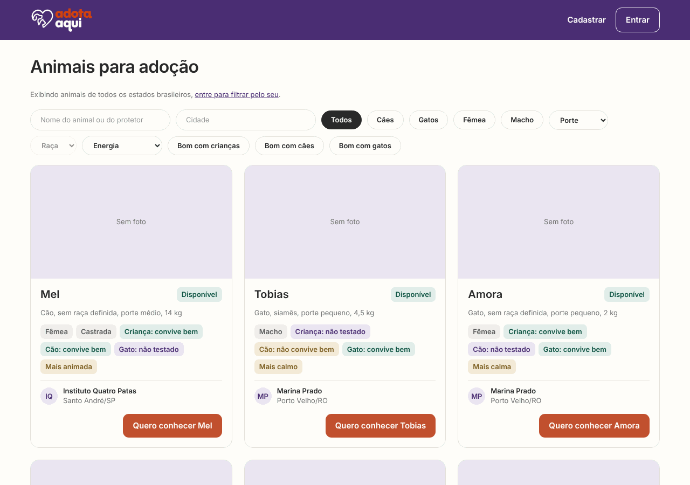

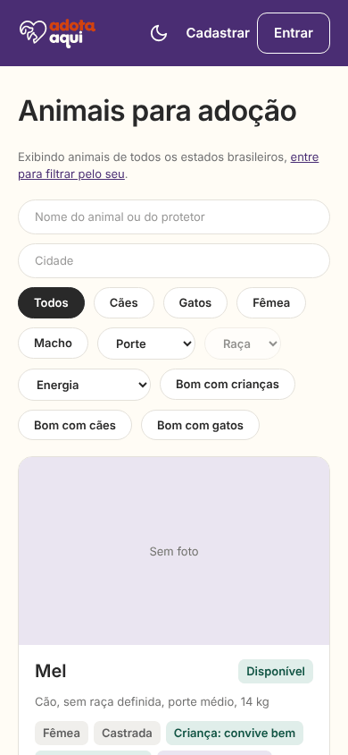

**Números do site.** A faixa "O Adota Aqui em números" mostra quantas adoções já foram feitas pelo site, quantos animais estão esperando um lar e quantos abrigos e ONGs estão cadastrados (`GET /api/estatisticas`, ERS 6.7). Adoção é interesse aprovado, então uma devolução não tira a adoção da conta. Os números contam o site todo, sem o filtro de estado. Enquanto carrega, os três cartões já ocupam o lugar, pra vitrine não pular. Se a API falhar, a faixa some sem mensagem de erro: ela é um extra, e o resto da página continua funcionando.

**O que faz.** Lista os animais disponíveis pra adoção, com filtros (RF07, UC06). Aparece na página inicial e em `/animais`.

**Como funciona.**

1. Visitante e Abrigo veem animais de todos os estados. Pessoa física logada vê só os que estão no próprio estado (RF14). Vale onde o animal está, que o protetor informa no cadastro e pode mudar na edição, e não o endereço de quem cadastrou.
2. Busca por nome e filtros: cidade, espécie, sexo, porte, raça (liberada depois de escolher a espécie), nível de energia e convivência ("Bom com crianças", "Bom com cães", "Bom com gatos"). As listas começam em "Todos os portes", "Todas as raças" e "Qualquer energia", já marcados, como o "Todos os estados" de Abrigos e protetores. Antes a primeira opção era o nome do filtro, e no celular "Raça" parecia uma raça (retorno do QA). No filtro, a raça "Outra" do cadastro aparece como "Outras raças", pra não confundir com "Sem raça definida".
3. A cada mudança, o front espera 300 ms sem mudança nova (assim não busca a cada letra digitada na cidade) e chama `GET /api/animais` com os filtros no endereço.
4. Cada cartão mostra nome, descrição (espécie, raça, porte e peso), tags de convivência, o protetor com a cidade e o estado onde o animal está, e o botão "Quero conhecer". O filtro de cidade também procura na cidade do animal. Animal que está no site há 1 mês ou mais ganha, em cima da foto, o selo "Esperando há 3 meses" (contado pelo `cadastradoEm` que a API manda), pra quem espera há mais tempo chamar atenção.
5. Os animais vêm de 12 em 12, dos cadastrados mais recentes pros mais antigos. Em "Ordenar por", a opção "Esperando há mais tempo" inverte: primeiro quem está no site há mais tempo (`ordem=MAIS_ANTIGOS`). A ordem não é filtro, então não liga o "Limpar filtros" e continua quando a pessoa limpa. Embaixo da grade aparece "Mostrando 12 de 37 animais" e o botão "Ver mais animais", que traz a próxima página embaixo das que já estavam na tela e leva o foco pro primeiro animal novo. Na última página o botão some. Se a próxima página falhar, os animais que já estavam continuam, e aparece "Não foi possível carregar mais animais. Tente de novo.". Mudar um filtro volta pra primeira página.
6. Sem resultado com os filtros: "Nenhum resultado encontrado com essas informações.", com uma foto, a dica "Tente tirar algum filtro ou buscar por outro nome." e o botão "Ver todos os animais" (UC06 FA02). Sem nenhum animal no estado da pessoa: "Nenhum animal disponível no seu estado no momento." (UC06 FA01).
7. Se a API não responder: "Não foi possível carregar os animais.", com o botão "Tentar de novo", que busca outra vez sem perder os filtros.

**Busca por nome.** O campo "Nome do animal ou do protetor" procura no nome do animal e no nome de quem cadastrou, pessoa ou abrigo: "mel" acha a Mel, e "quatro patas" acha os animais do Instituto Quatro Patas. Soma com os outros filtros e aceita até 80 caracteres.

**Busca por cidade e por nome.** As duas acham por parte do texto e ignoram acentos e maiúsculas: "sao" acha "São Paulo". O back tira os acentos do que foi digitado e, no banco, compara com o valor também sem acento (`translate` e `lower`), usando `LIKE` com o texto no meio. Funciona igual no PostgreSQL e no H2 dos testes.

**Onde está no código.**

- Front: `pages/Home`, `components/Apresentacao`, `components/Estatisticas`, `components/ComoFunciona`, `components/VitrineAnimais`, `components/FiltrosAnimais`, `components/CardAnimal`, `services/animais.js` e `services/estatisticas.js`
- Back: `AnimalController`, `AnimalService`, `AnimalFiltroRequest`, `AnimalSpecifications`, `PaginaResponse`, `EstatisticasController` e `EstatisticasService`

**Como fica no banco.** A coluna `cadastrado_em` da tabela `animal` guarda quando o animal foi cadastrado, e é por ela que a vitrine ordena e que o selo de espera conta. Nos animais que já existiam quando a coluna foi criada (31/10/2026), o banco preencheu com a data daquele deploy, então eles só ganham o selo um mês depois disso.

**Testes.** `AnimalIntegrationTest` (estado, status, filtros combinados, cidade, busca por nome sem acento, páginas, as duas ordens e limites da paginação), `ErroApiIntegrationTest` (filtro com valor inválido), `VitrineAnimais.test.jsx` (inclusive o "Ver mais animais" e o "Ordenar por"), `CardAnimal.test.jsx`, `Home.test.jsx`, `EstatisticasIntegrationTest` e `Estatisticas.test.jsx`.

---

## 5. Perfil do animal

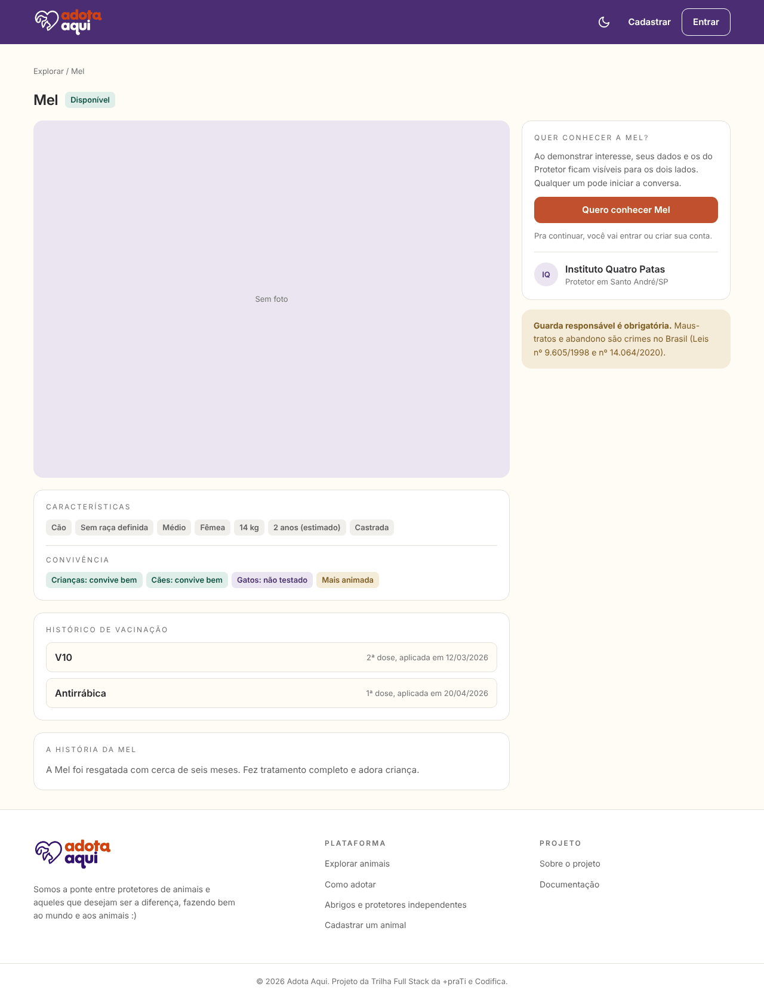

**O que faz.** Mostra tudo sobre um animal: fotos, características, convivência, vacinas e a história. O quadro do lado muda conforme quem está vendo.

**Como funciona.**

- Galeria com a foto principal grande e miniaturas clicáveis.
- Características: espécie, raça, porte, sexo, peso, idade estimada (calculada pela data de nascimento estimada) e se é castrado.
- Convivência com crianças, cães e gatos em tags coloridas (verde: convive bem; amarelo: não convive bem; roxo: não testado), e o nível de energia.
- Histórico de vacinação, quando tem, e a história do animal.
- O selo "Esperando há 3 meses" do lado do "Disponível", pra animal que está no site há 1 mês ou mais.
- O quadro "Ajude a Mel a achar um lar", com "Enviar no WhatsApp" (um texto pronto com o link do perfil), "Copiar link" e, no navegador que tem o menu de compartilhar do sistema (quase todo celular), "Outros apps". Animal adotado não tem o quadro.
- Aviso de guarda responsável e o link pras clínicas veterinárias perto de onde o animal está ([seção 16](#16-clínicas-veterinárias-perto-de-você)).

**Prévia do link.** Quem manda um link do site no WhatsApp ou nas redes vê uma prévia com o nome, uma frase e a imagem do Adota Aqui (`frontend/public/compartilhar.png`, nas tags `og:` do `index.html`). A prévia é a mesma pra todas as páginas: o site monta as telas no navegador, e o WhatsApp não roda o JavaScript pra ler o nome do animal. Por isso o texto pronto do "Enviar no WhatsApp" já leva o nome e a cidade do animal.

O quadro do lado:

| Quem vê                                  | O que aparece                                         |
| ---------------------------------------- | ----------------------------------------------------- |
| Visitante                                | "Quero conhecer {nome}", que leva ao login            |
| Pessoa física do mesmo estado            | "Quero conhecer {nome}"                               |
| Pessoa física com interesse em andamento | O status do interesse e "Desistir da adoção"          |
| Pessoa física de outro estado            | Aviso de que a adoção acontece dentro do mesmo estado |
| Abrigo                                   | Aviso de que conta de abrigo não demonstra interesse  |
| Protetor do animal                       | "Editar {nome}" e "Ver interesses recebidos"          |

**Regras.** O back já manda o que o front precisa pra decidir o quadro: `ehMeu`, `podeDemonstrarInteresse` e `meuInteresse`. Animal adotado só aparece pro protetor dele. Pros outros, a resposta é `404` "Animal não encontrado".

**Onde está no código.**

- Front: `pages/PerfilAnimal`, `components/GaleriaFotos`, `components/CompartilharAnimal` e `utils/rotulos.js` (`tempoEsperando`)
- Back: `AnimalController`, `AnimalService` e `AnimalMapper`

**Testes.** `AnimalIntegrationTest` (permissões, interesse ativo e a data de cadastro no perfil), `PerfilAnimal.test.jsx`, `CompartilharAnimal.test.jsx` e `rotulos.test.js`.

---

## 6. Cadastro, edição e remoção de animal (CRUD)

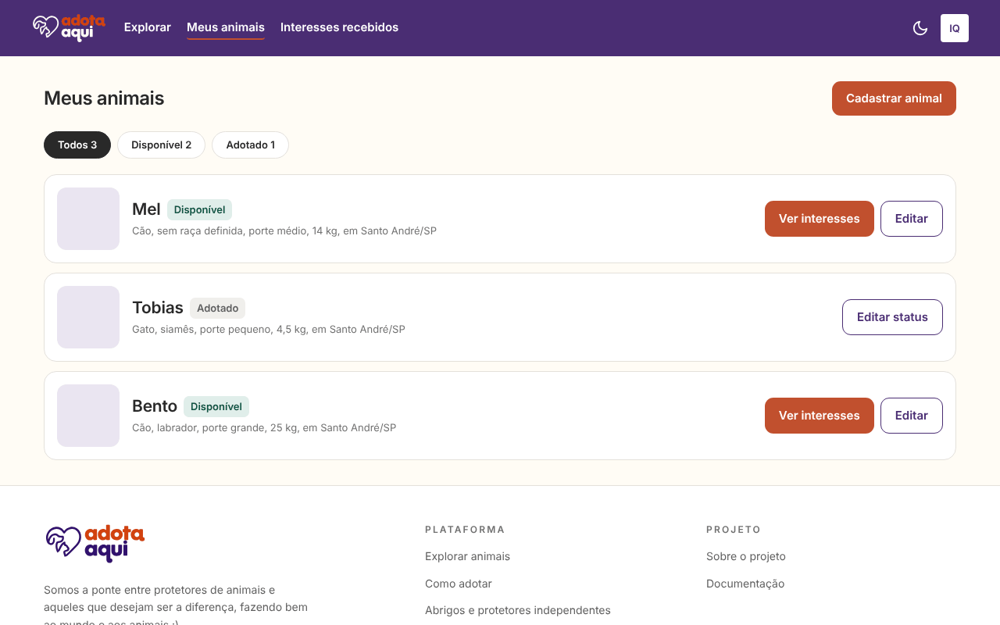

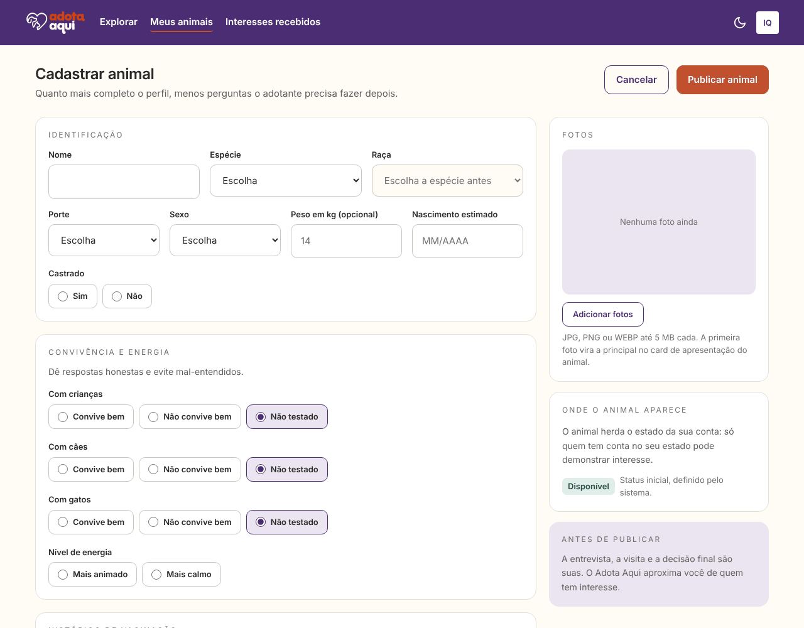

**O que faz.** O protetor, pessoa física ou abrigo, cadastra, vê, edita e remove os animais dele (RF04, RF05, RF06), com fotos (RF16). É o CRUD principal do sistema.

**Cadastrar (create).**

1. Em Meus animais, "Cadastrar animal".
2. O formulário tem partes: identificação (nome, espécie, raça, porte, sexo, peso, nascimento estimado em MM/AAAA e se é castrado), convivência e energia, vacinas (quantas quiser), trajetória do animal e fotos.
3. Cada foto escolhida sobe na hora pro `POST /api/fotos`, que guarda o arquivo no Amazon S3 e devolve o endereço. A primeira é a principal, e dá pra trocar qual é a principal ou remover uma foto.
4. "Publicar animal" manda tudo pro `POST /api/animais`. O animal já nasce Disponível e aparece na vitrine.
5. No computador, "Cancelar" e "Publicar animal" ficam no topo, ao lado do título, como no Figma. No celular e no tablet, ficam no fim do formulário, depois do último quadro, pra ninguém precisar rolar até o topo pra salvar. O aviso de erro do envio e a confirmação da devolução aparecem logo acima desses botões. O mesmo vale pra edição ("Salvar alterações").

**Ver (read).** Meus animais (`GET /api/animais/meus`) lista os animais da conta, disponíveis e adotados, com os filtros Todos, Disponível e Adotado. Animal disponível tem "Ver interesses" e "Editar". Adotado tem "Editar status". Conta sem nenhum animal vê uma foto, "Você ainda não cadastrou nenhum animal." e o botão pra cadastrar o primeiro. Se a lista não carregar, aparece "Tentar de novo".

**Editar (update).** O mesmo formulário, já preenchido, manda tudo pro `PUT /api/animais/{id}`.

- Animal disponível: dá pra mudar todos os dados. O status não muda por aqui: o animal só vira Adotado quando o protetor aprova um interesse.
- Animal adotado: os dados ficam travados e só o status muda (RF06). Escolher "Disponível (devolução)" destrava os campos, pede confirmação ("Tornar {nome} disponível de novo?") e devolve o animal pra vitrine, já com os dados que a pessoa mudou nessa mesma tela. Continuando Adotado, qualquer dado alterado é recusado (`409`). O interesse aprovado continua no histórico.

**Remover (delete).** "Remover {nome}" pede confirmação ("Remover {nome} de vez?") e chama `DELETE /api/animais/{id}`. Saem junto as vacinas, as fotos e os interesses do animal. As fotos saem do banco e também do S3 (ver a regra abaixo).

Depois de cada ação, Meus animais mostra um aviso: "{nome} foi publicado e já aparece na vitrine.", "As alterações em {nome} foram salvas." ou "{nome} foi removido.".

**Regras e validações.**

- Obrigatórios: nome (até 80 caracteres), espécie, raça, porte, sexo, nascimento estimado, castrado, convivência com crianças, cães e gatos (começa em "Não testado"), nível de energia, trajetória, onde o animal está (cidade e estado) e pelo menos uma foto. O peso é opcional.
- Onde o animal está: no cadastro, a cidade e o estado já vêm com o endereço da conta (o front busca o perfil) e o protetor troca se o animal estiver em outro lugar, como na casa de outra pessoa ou num lar temporário. Na edição, o protetor muda quando o animal muda de cidade. Pedido do tutor na reunião de 04/11. Na API os dois são opcionais e andam juntos: sem eles, o animal fica no endereço do protetor; só um deles, `400`.
- A raça precisa ser da espécie escolhida: `400`, com "A raça não pertence à espécie informada" no campo `racaDaEspecie`, que o front mostra embaixo do campo Raça.
- Nascimento estimado: mês de 01 a 12, ano a partir de 1990 e nunca no futuro. Vacina: nome obrigatório, dose e data opcionais, e data no futuro não vale.
- Fotos: JPG, PNG ou WEBP de até 5 MB. O back confere o tipo pelos primeiros bytes do arquivo, não pelo nome. Renomear um PDF pra .jpg não passa.
- Só o protetor do animal edita ou remove (`403`). Mudar os dados de um animal adotado: `409`. Tentar marcar como adotado pelo formulário: `409` "A adoção deve ser registrada pela aprovação de um interesse".
- Enquanto salva uma edição, o animal fica travado no banco (`SELECT ... FOR UPDATE`), pra não brigar com uma aprovação acontecendo ao mesmo tempo.

**Como fica no banco.** Tabela `animal` (os enums ficam como texto; tem `usuario_id` ou `abrigo_id`, nunca os dois, garantido por um `CHECK`), `animal_foto` (animal, ordem e endereço) e `vacina`. A tabela `animal` guarda também `cidade` e `estado`, onde o animal está. Os animais que já existiam antes dessas colunas ganham o endereço do protetor quando o back sobe (`LocalDosAnimaisAntigos`). As imagens ficam no S3, e o banco guarda só o endereço delas (RF16).

**Onde está no código.**

- Front: `pages/MeusAnimais`, `pages/CadastroAnimal`, `pages/EditarAnimal`, `components/FormularioAnimal`, `components/EnvioFotos`, `components/ListaVacinas`, `utils/formularioAnimal.js` e `services/fotos.js`
- Back: `AnimalController`, `AnimalService`, `AnimalMapper`, `FotoController`, `FotoService` e `ArmazenamentoS3`

**Testes.** `AnimalIntegrationTest` (dono, troca de fotos e vacinas, adotado só muda o status, remoção em cascata), `FotoIntegrationTest` (tipo e tamanho da imagem), `RacaIntegrationTest`, `CadastroAnimal.test.jsx`, `EditarAnimal.test.jsx`, `FormularioAnimal.test.jsx` e `MeusAnimais.test.jsx`.

---

## 7. Demonstrar interesse e desistir

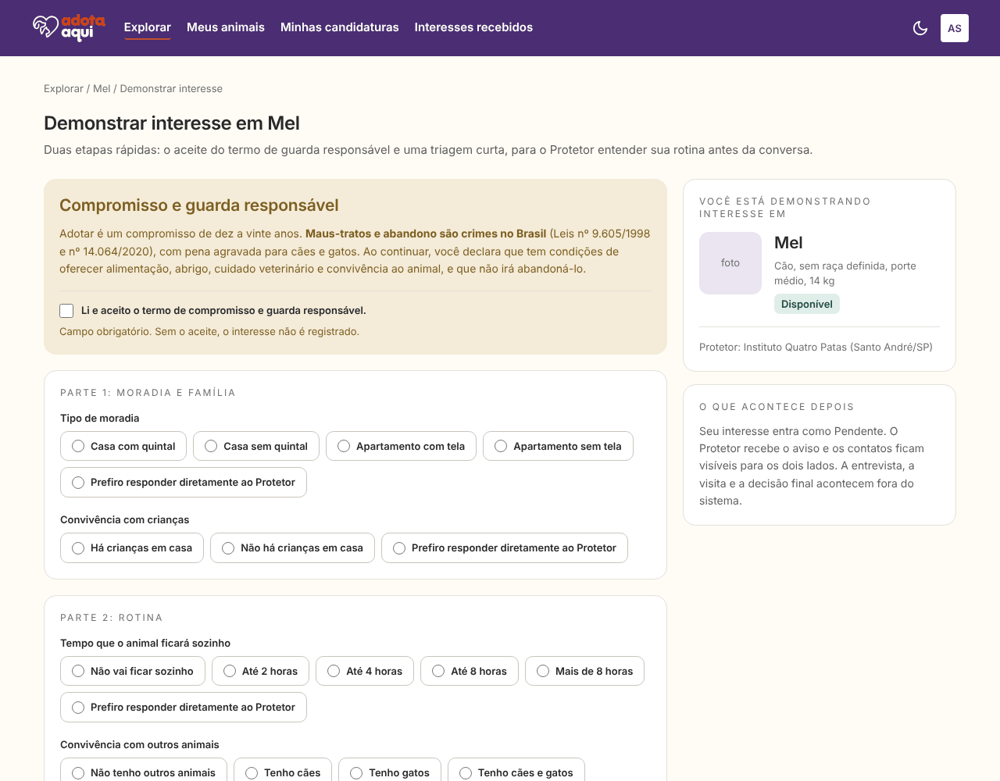

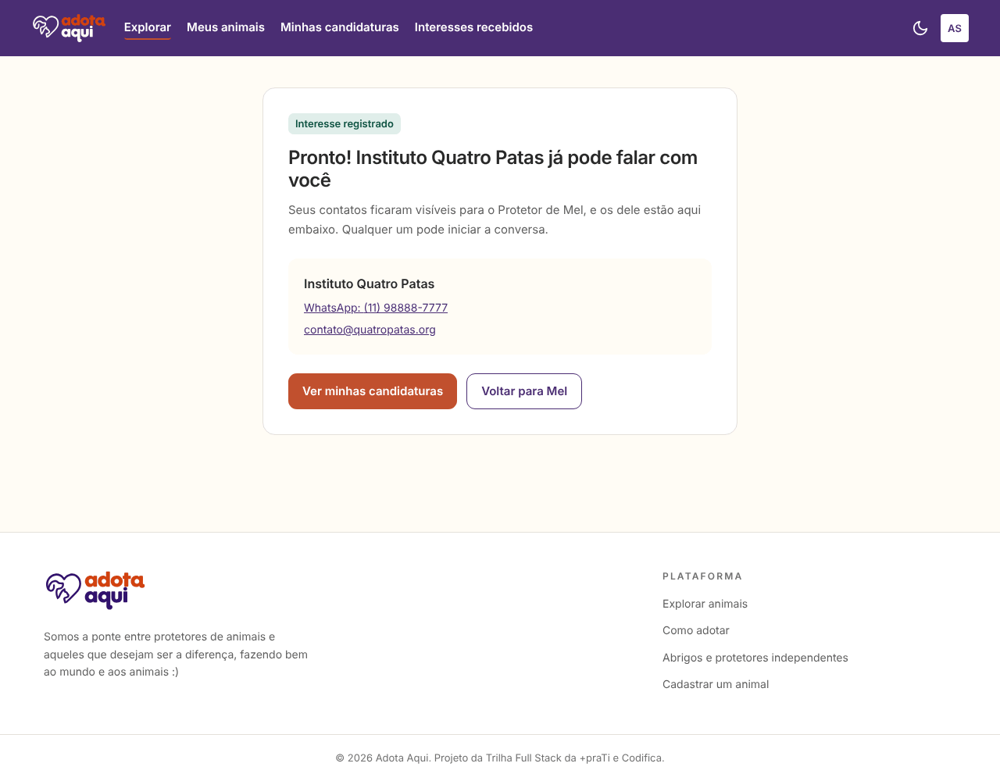

**O que faz.** A pessoa física aceita o termo de guarda responsável, responde uma triagem curta e registra o interesse em um animal (RF08, RF13, RF15, UC07). Na hora, os contatos ficam visíveis pros dois lados (RF09): ela vê o WhatsApp e o e-mail do protetor, e o protetor vê os dela no painel.

**Como funciona.**

1. No perfil do animal, "Quero conhecer {nome}". Visitante vai pro login antes.
2. Compromisso e guarda responsável: o texto com as leis (9.605/1998 e 14.064/2020) e a caixa "Li e aceito o termo de compromisso e guarda responsável.". Sem marcar, não dá pra continuar.
3. Triagem em três partes: moradia e família (tipo de moradia, crianças), rotina (tempo sozinho, outros animais, viagens) e contato (melhor momento). Nas duas primeiras, toda pergunta tem a opção "Prefiro responder diretamente ao Protetor". A de contato não tem, porque é ela que faz a ponte funcionar.
4. "Confirmar interesse" manda tudo pro `POST /api/animais/{id}/interesses`. O interesse começa como Pendente.
5. Tela de confirmação: "Pronto! {protetor} já pode falar com você", com o link do WhatsApp e o e-mail do protetor.

**Desistir.** Com o interesse Pendente ou Em contato, o perfil do animal mostra "Desistir da adoção". Depois da confirmação, o front chama `DELETE /api/interesses/{id}` e o interesse é apagado.

**Regras, na ordem em que o back confere.**

1. Sem login: `401`.
2. Termo não aceito ou triagem incompleta (as seis respostas são obrigatórias): `400`.
3. Conta de abrigo: `403` "Contas de abrigo não demonstram interesse. Para adotar, use uma conta pessoal (CPF)".
4. Animal que não existe: `404`.
5. Animal da própria pessoa: `403`.
6. Animal de outro estado: `403` "Só é possível demonstrar interesse em animais do seu estado" (RF14).
7. Animal que não está disponível: `409`.
8. Já existe um interesse Pendente ou Em contato da pessoa nesse animal: `409` "Você já demonstrou interesse neste animal".

Só quem demonstrou o interesse desiste dele, e só enquanto ele está Pendente ou Em contato.

**Como fica no banco.** Tabela `interesse`: data e hora, status, motivo da descontinuação, as seis respostas da triagem, o candidato e o animal. Uma regra do banco (`CHECK`) exige o motivo quando o status é Descontinuado.

**Onde está no código.**

- Front: `pages/DemonstrarInteresse`, `utils/triagem.js` e `services/interesses.js`
- Back: `InteresseController`, `InteresseService` e `InteresseMapper`

**Testes.** `InteresseIntegrationTest`, `DemonstrarInteresse.test.jsx` e `triagem.test.js`.

---

## 8. Painel de interesses recebidos

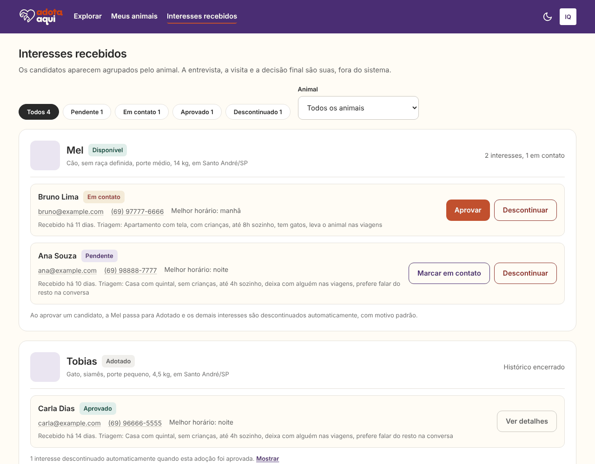

**O que faz.** O protetor vê quem demonstrou interesse nos animais dele, com contatos e triagem, e registra o andamento de cada candidato até a adoção (RF09, RF10, UC08). No MVP, a notificação do RF09 é o próprio painel: interesse novo aparece como Pendente. Não tem envio de e-mail.

**Como funciona.**

1. Os candidatos aparecem agrupados por animal. Cada cartão tem a foto, o nome e o status do animal, e um resumo ("2 interesses, 1 em contato" ou "Histórico encerrado"). Essa contagem só o protetor vê (RF12).
2. Em cada candidato: nome, status, e-mail, WhatsApp, melhor horário e a triagem resumida numa frase.
3. Filtros por status (Todos, Pendente, Em contato, Aprovado e Descontinuado, cada um com a quantidade) e por animal. O animal escolhido fica no endereço (`?animal=id`), por isso o "Ver interesses" de Meus animais já abre filtrado.
4. Ações:
   - Pendente: "Marcar em contato" ou "Descontinuar".
   - Em contato: "Aprovar" ou "Descontinuar".
   - Aprovado e Descontinuado: só "Ver detalhes", com a triagem completa.
5. Descontinuar pede um motivo de até 255 caracteres, que o candidato vai ler. Aprovar pede confirmação.
6. Os descontinuados ficam recolhidos no fim de cada cartão, com o botão "Mostrar".

**O que acontece ao aprovar (RF10).** Tudo numa transação só:

1. o interesse vira Aprovado;
2. o animal vira Adotado e sai da vitrine;
3. os outros interesses Pendente ou Em contato do mesmo animal viram Descontinuado, com o motivo "Outro candidato foi aprovado para este animal.".

Se qualquer parte falhar, nada é salvo. O animal fica travado no banco durante a operação, então duas aprovações ao mesmo tempo não geram duas adoções: uma passa e a outra recebe `409`.

**Regras.**

- Só o protetor do animal mexe nos interesses dele: `403` "Somente o protetor do animal pode gerenciar este interesse".
- Transições permitidas: de Pendente para Em contato, Aprovado ou Descontinuado; de Em contato para Aprovado ou Descontinuado. Aprovado e Descontinuado não mudam mais. Qualquer outra: `409` "Transição de status não permitida para este interesse".
- Descontinuar sem motivo: `400`. Aprovar um animal que já foi adotado: `409` "Este animal já está adotado".
- O painel não mostra "Aprovar" pra quem está Pendente. Segue o fluxo do Figma, em que primeiro se conversa (Em contato) e depois se aprova, mas a API aceita a aprovação direta.

**Onde está no código.**

- Front: `pages/InteressesRecebidos`, `components/InteressesDoAnimal` e `components/InteresseRecebido`
- Back: `InteresseController`, `InteresseService` e `InteresseRepository`

**Testes.** `InteresseIntegrationTest` (filtros, dono, transições, aprovação, aprovações ao mesmo tempo, transação desfeita quando algo falha) e `InteressesRecebidos.test.jsx`.

---

## 9. Minhas candidaturas

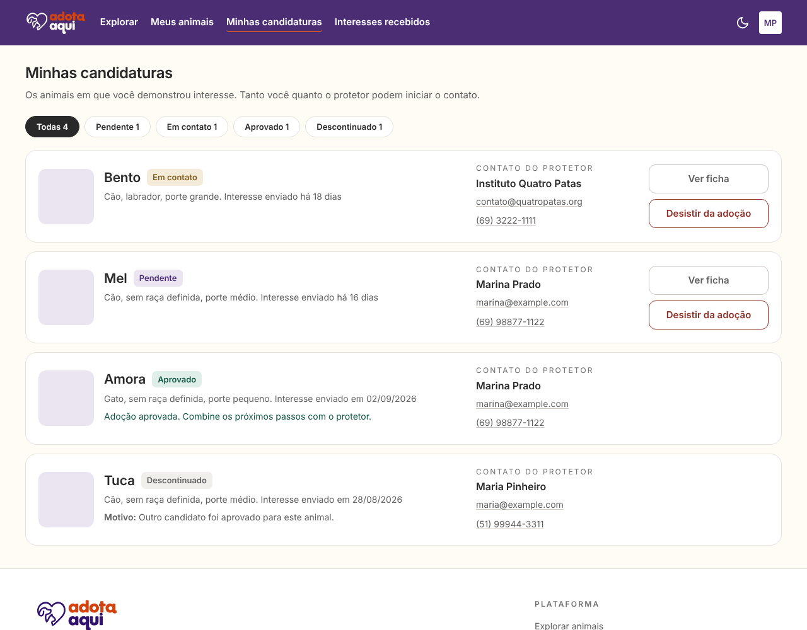

**O que faz.** A pessoa acompanha os animais em que demonstrou interesse: em que pé está cada candidatura e o contato do protetor, pra ela também poder puxar a conversa (RF09, UC07). Só pessoa física tem essa tela.

**Como funciona.**

1. Um cartão por candidatura, com a foto, o nome e o status do animal, a espécie, a raça e o porte, e há quanto tempo o interesse foi enviado.
2. Em cada cartão, o contato do protetor: nome, e-mail e WhatsApp.
3. As em andamento (Em contato e Pendente) vêm primeiro, depois a Aprovada e as Descontinuadas.
4. Filtros por status: Todas, Pendente, Em contato, Aprovado e Descontinuado, cada um com a quantidade.
5. Aprovada mostra "Adoção aprovada. Combine os próximos passos com o protetor." e, até 30 dias depois da aprovação, o convite pra contar como foi a adoção (ver [Histórias de adoção](#12-histórias-de-adoção-depoimentos)). Descontinuada mostra o motivo que o protetor escreveu.
6. "Ver ficha" só aparece com o animal disponível: animal adotado só abre pro protetor dele.
7. "Desistir da adoção" só aparece nas candidaturas Pendente ou Em contato. Pede confirmação, apaga o interesse (o mesmo `DELETE` do perfil do animal) e o cartão some da lista, com um aviso no topo.
8. Sem nenhuma candidatura, aparece um convite pra ver os animais disponíveis.

**Regras.**

- Cada pessoa só vê as próprias candidaturas: a conta sai do token.
- Sem login: `401`. Conta de abrigo: `403` "Contas de abrigo não têm candidaturas. Para adotar, use uma conta pessoal (CPF)".
- O interesse traz um resumo do animal com o `statusAdocao`, que é o que decide se o "Ver ficha" aparece (`docs/api.md`, formato do interesse).

**Onde está no código.**

- Front: `pages/MeusInteresses`, `components/Candidatura` e `services/interesses.js`
- Back: `InteresseController`, `InteresseService` e `InteresseRepository` (`findByUsuarioIdOrderByDataHoraDescIdDesc`)

**Testes.** `InteresseIntegrationTest` (só as da pessoa, contato do protetor, motivo, `401` e `403`) e `MeusInteresses.test.jsx`.

---

## 10. Meu perfil

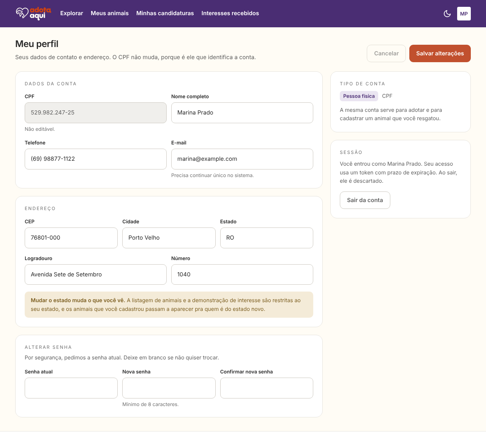

**O que faz.** A pessoa ou o abrigo vê e edita os dados da conta e troca a senha (RF17, UC10). O CPF e o CNPJ aparecem, mas não mudam, porque é com eles que se entra.

**Como funciona.**

1. A tela abre com os dados da conta: documento (só leitura), nome, telefone, e-mail e endereço. O abrigo também tem a razão social.
2. O endereço funciona igual ao do cadastro: o CEP preenche cidade, estado e logradouro pelo ViaCEP, e os campos continuam editáveis.
3. Um aviso explica que mudar o estado muda o que a pessoa vê na vitrine e onde os animais dela aparecem (RF14).
4. A troca de senha fica na mesma tela e é opcional: com os três campos em branco, a senha não muda. Começou a preencher, os três passam a ser obrigatórios.
5. "Salvar alterações" manda os dados (`PUT`) e, se a senha foi preenchida, troca a senha logo depois (`PATCH`). Se nada mudou, avisa que não há o que salvar.
6. "Cancelar" volta tudo pro que está salvo. O nome novo aparece no menu na hora, sem entrar de novo.
7. "Sair da conta" continua na mesma tela.
8. No computador, "Cancelar" e "Salvar alterações" ficam no topo, ao lado do título. No celular e no tablet, ficam logo depois de "Alterar senha", com o aviso de erro logo acima, antes dos quadros "Tipo de conta" e "Sessão".

**Regras.**

- A conta sai do token (`/me`), nunca de um id no endereço. Pessoa usa `/api/usuarios/me` e abrigo usa `/api/abrigos/me`; o outro tipo recebe `403`.
- O e-mail continua único entre pessoas e abrigos, sem diferença de maiúsculas: `409` "Já existe uma conta cadastrada com este e-mail", mostrado embaixo do campo.
- A senha nova segue a regra do cadastro (8 a 72 caracteres) e precisa ser confirmada.
- Senha atual errada: `400`, e não `401`, pra não deslogar a pessoa. A mensagem aparece embaixo da senha atual.
- Mudar o estado muda a vitrine da pessoa. Os animais que ela cadastrou continuam onde estão: cada animal tem o próprio local, que se muda na edição do animal. O aviso embaixo do endereço explica isso.

**Onde está no código.**

- Front: `pages/Perfil`, `services/perfil.js`, `utils/validacoes.js` (`validarPerfil` e `validarTrocaDeSenha`) e `contexts/AuthContext.jsx` (`atualizarNome`)
- Back: `PerfilController` e `PerfilService`

**Testes.** `PerfilIntegrationTest` (ver, editar, e-mail repetido, outro tipo de conta, troca de senha, senha atual errada e a mudança de estado na vitrine) e `Perfil.test.jsx`.

---

## 11. O que vale pro sistema todo

- **Erros no mesmo formato.** Toda resposta de erro da API tem `status`, `erro`, `mensagem`, `campos` (quando o erro é num campo) e `timestamp`, em português. O front mostra a `mensagem` e põe cada erro de `campos` embaixo do campo certo (`GlobalExceptionHandler`, `ErroResponse` e `services/api.js`).
- **Servidor acordando.** O Render desliga a API depois de 15 minutos sem uso. Quando uma tela passa de 4 segundos carregando, aparece "O servidor estava parado e está acordando. Isso pode levar até 1 minuto." (`components/Carregando`).
- **Responsivo (RNF01).** As telas funcionam no celular, no tablet e no computador, seguindo os três tamanhos do Figma. Na revisão da #36, todas as telas foram conferidas de 320 a 1440 px de largura: nenhuma tem rolagem pro lado, o menu de quem está logado nunca esconde item, os botões descem pra baixo do texto no celular e os links que ficam soltos, fora de uma frase, têm pelo menos 24 px de altura pra tocar.
- **Tema claro e escuro.** O botão de lua e sol no topo troca o tema, e a escolha fica salva no navegador. Quem nunca escolheu segue o tema do sistema operacional. Um script curto no `index.html` aplica o tema antes da página aparecer, pra não piscar claro antes de ficar escuro. As cores dos dois temas estão no `styles/index.css`; no escuro, o roxo, o texto terciário e os textos das tags ficaram um pouco mais claros que no Figma, pra passar no contraste mínimo de 4,5:1 (WCAG AA). Código: `hooks/useTema.js` e `components/BotaoTema`. Teste: `BotaoTema.test.jsx`.

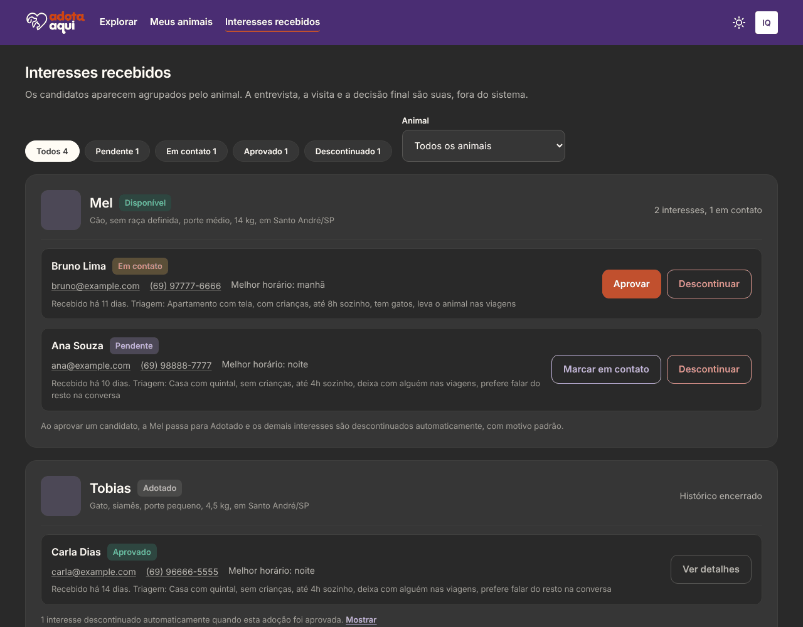

- **Título da aba e rolagem.** Cada página põe o nome dela no título da aba do navegador ("Meus animais | Adota Aqui"), e toda página nova abre no topo. O "Como adotar" do rodapé rola até a seção, e o voltar do navegador devolve a pessoa onde ela estava (`hooks/useTituloDaPagina.js` e `components/RolarParaOTopo`).
- **Rodapé** em todas as telas que têm o menu do topo, com o logo, a frase do Figma e os links da plataforma: quem somos, explorar animais, como adotar, histórias de adoção, blog para tutores, abrigos e protetores independentes, feiras de adoção, clínicas veterinárias e cadastrar um animal (`components/Rodape`, `Rodape.test.jsx`).
- **Patinhas.** Com mouse, o caminho dele vai deixando pegadas laranja, uma de cada lado como quem anda, que somem em menos de 1 segundo. A setinha do mouse continua igual (`components/RastroDePatas`, no `App.jsx`). No fundo da faixa roxa "Como funciona a adoção" e do painel roxo do login e do cadastro, uma trilha de pegadas laranja clarinha aparece uma pegada depois da outra, sem parar (`components/TrilhaDePatas`). As duas são enfeite: o leitor de tela pula e o clique passa direto. Quem pediu menos movimento no sistema não vê o rastro do mouse e vê a trilha parada. No celular não tem rastro (não tem mouse), e a trilha do login só aparece no computador. A conta que espalha as pegadas na curva é a mesma da ponte do Quem somos (`utils/curva.js`). Testes: `RastroDePatas.test.jsx`, `TrilhaDePatas.test.jsx` e `curva.test.js`.
- **Página não encontrada** pra qualquer endereço que não existe, com foto e os botões "Ver animais disponíveis" e "Ir para a página inicial". Animal que não existe (perfil, interesse ou edição) mostra a mesma foto com "Animal não encontrado".
- **Integração contínua.** A cada push e PR na `dev` e na `main`, o GitHub Actions roda os testes do back (`mvn verify`) e do front (build e `npm run test:coverage`) e guarda os relatórios de cobertura (JaCoCo e lcov). A cobertura aparece no resumo de cada execução, e o CI falha se a de linhas ficar abaixo de 70% (RNF04). O PR só entra com os dois verdes.
- **Deploy (RNF06).** Front no Netlify, API no Render (com Docker), banco PostgreSQL no Neon e fotos no Amazon S3. Os endereços estão no [README principal](../README.md).

---

## 12. Histórias de adoção (depoimentos)

**O que faz.** Quem adotou pelo site conta como está a vida com o animal, com uma foto se quiser, e a história vai pro mural público de histórias de adoção (RF11, UC09, ERS 6.3). A Home mostra as 3 mais novas.

**Como funciona.**

1. Quando o protetor aprova o interesse, a candidatura aprovada passa a mostrar "Contar como foi a adoção" em Minhas candidaturas, com o prazo: "Dá pra contar até 28/11/2026." (30 dias depois da aprovação, ERS 6.3).
2. O botão abre `/meus-interesses/{id}/depoimento`: "Como está sendo a vida com {nome}?", o texto (de 10 a 1000 caracteres, com o contador), uma foto opcional (UC09 FA02) e a autorização pra publicar no mural.
3. Sem texto ou sem autorizar, não envia, marca o que falta e leva o foco pro primeiro problema (UC09 FA01).
4. Publicada, a pessoa volta pra Minhas candidaturas com o aviso "Sua história com {nome} foi publicada no mural.", e o cartão passa a mostrar o link do mural e "Apagar minha história", que pede confirmação.
5. O mural fica em `/historias`, aberto pra qualquer pessoa, também no rodapé ("Histórias de adoção"). Cada história mostra a foto (a do depoimento ou, sem ela, a do animal), o nome do animal, o texto, o primeiro nome e o estado de quem contou, o protetor e a data. Vem de 12 em 12, com o "Ver mais histórias".
6. Na Home, a seção "Histórias de quem adotou" mostra as 3 mais novas e o link "Ver todas as histórias". Sem nenhuma história, ou com a API fora do ar, a seção nem aparece.

**Regras.**

- Só a pessoa que adotou escreve, uma vez por adoção, e só se for a adoção atual do animal: aprovada, com o animal Adotado e sem outra aprovação depois (uma devolução seguida de uma nova adoção passa a vez pra quem adotou por último).
- Prazo de 30 dias a partir da aprovação. Interesse aprovado antes de existir a data da aprovação fica sem prazo.
- O mural é público, então a pessoa precisa autorizar, e do adotante só aparecem o primeiro nome e o estado. O sobrenome, o e-mail e o telefone não saem da API.
- A foto tem que ter sido enviada pelo próprio site (`POST /api/fotos`). URL de outro site é recusada, pra ninguém colocar no mural uma imagem que não passou pela conferência.
- Quem escreveu pode apagar a história quando quiser, e a foto sai também do S3. Ainda no prazo, dá pra contar de novo.
- Remover o animal apaga junto os depoimentos das adoções dele (o banco apaga em cascata) e as fotos do S3.
- Erros: sem login `401`, conta de abrigo ou interesse de outra pessoa `403`, interesse que não existe `404`, adoção não aprovada, prazo acabado ou história já contada `409`.

**Como fica no banco.** Tabela `depoimento` (id, `interesse_id` único, texto até 1000 caracteres, `foto_url` e `data_hora`), com chave estrangeira pro interesse e `on delete cascade`. O interesse ganhou a coluna `aprovado_em`, preenchida quando o protetor aprova.

**Onde está no código.**

- Front: `pages/Historias`, `pages/EscreverDepoimento`, `components/CardDepoimento`, `components/HistoriasRecentes`, `components/Candidatura`, `components/CampoTextoLongo`, `components/EnvioFotoUnica` e `services/depoimentos.js`
- Back: `DepoimentoController`, `DepoimentoService`, `DepoimentoRepository`, `Depoimento`, `DepoimentoRequest`, `DepoimentoResponse` e `PaginaRequest`

**Testes.** `DepoimentoIntegrationTest` (o fluxo pela API, primeiro nome e estado no mural, prazo, só quem adotou, uma vez só, devolução, validações, apagar, remover o animal e as páginas do mural), `Historias.test.jsx`, `EscreverDepoimento.test.jsx`, `MeusInteresses.test.jsx` e `Home.test.jsx`.

---

## 13. Blog para tutores

**O que faz.** Os protetores escrevem artigos pra quem vai adotar e pra quem já adotou: adoção responsável, primeiros dias em casa, saúde e vacinas, comportamento e alimentação (ERS 6.4, Blog Educativo). Qualquer pessoa lê, sem login.

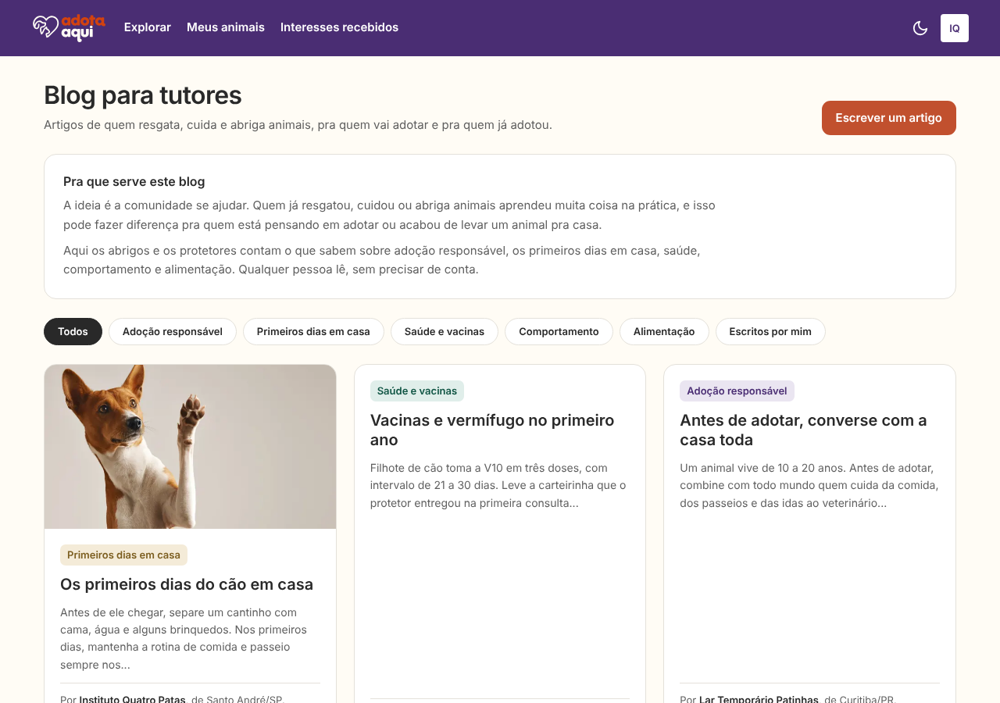

**Como funciona.**

1. O blog fica em `/blog`, também no rodapé ("Blog para tutores"). Logo no começo, o quadro "Pra que serve este blog" explica a ideia: a comunidade se ajudar, com quem já resgatou, cuidou ou abriga animais contando o que aprendeu na prática pra quem vai adotar ou acabou de adotar. O mesmo quadro diz como começar a escrever: o visitante é convidado a entrar na conta, e quem entrou mas ainda não cadastrou animal, a cadastrar um.
2. Cada artigo aparece num card com a capa (se tiver), o assunto, o título, o começo do texto, quem escreveu, a cidade e a data. Vem de 12 em 12, dos mais novos pros mais antigos, com o "Ver mais artigos". Os botões de assunto filtram a lista. Quem já escreveu algum artigo vê também o "Escritos por mim".
3. O título abre o artigo inteiro em `/blog/{id}`, com o texto em parágrafos (separados pelas linhas em branco) e a data da última edição, se tiver.
4. Protetor vê o "Escrever um artigo", que abre `/blog/novo`: título, assunto, foto de capa opcional e o texto, com o contador de caracteres. Faltando alguma coisa, marca o que falta e leva o foco pro primeiro problema.
5. Depois de publicar, a pessoa vai pro artigo com o aviso "Seu artigo foi publicado.". Quem escreveu vê ali o "Editar artigo" e o "Apagar artigo", que pede confirmação e volta pro blog com o aviso.
6. Pessoa que ainda não cadastrou animal e abre `/blog/novo` vê o convite pra cadastrar um. Quem abre a edição de um artigo de outra conta vê o aviso de que só quem escreveu pode editar.

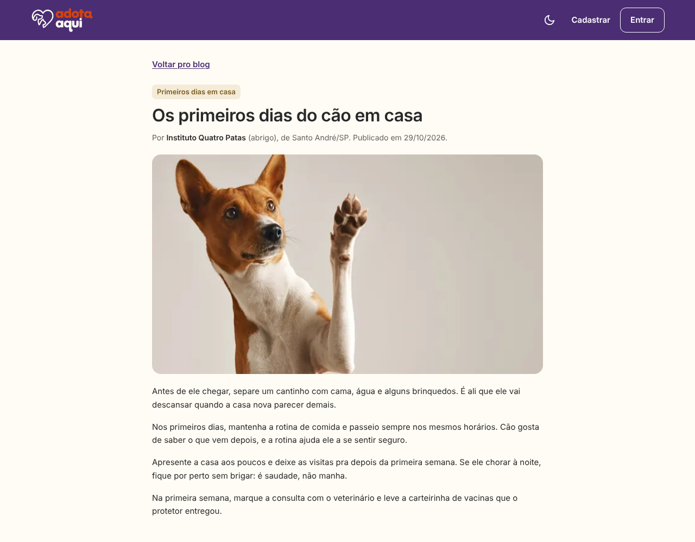

**Regras.**

- Escreve quem é protetor: um Abrigo, ou uma pessoa que já cadastrou pelo menos um animal. Os outros recebem `403`.
- Só quem escreveu edita e apaga. A API confere a conta do token, e não o que o front mostra.
- Título de 5 a 120 caracteres, texto de 50 a 10000 caracteres e um dos 5 assuntos.
- O texto é puro, sem HTML. O site mostra como texto, então ninguém consegue colocar um script ou um link escondido num artigo.
- A capa tem que ter sido enviada pelo próprio site (`POST /api/fotos`), como no depoimento. Trocar ou tirar a capa, ou apagar o artigo, apaga a imagem antiga do S3.
- Da conta que escreveu, o artigo mostra só o nome, o tipo, a cidade e o estado, como na vitrine.

**Como fica no banco.** Tabela `artigo` (id, `titulo`, `conteudo` em `text`, `categoria`, `foto_capa`, `usuario_id` ou `abrigo_id`, `publicado_em` e `atualizado_em`), com a mesma regra do animal: um autor só, pessoa ou abrigo (`check` no banco).

**Onde está no código.**

- Front: `pages/Blog`, `pages/Artigo`, `pages/FormularioArtigo`, `components/CardArtigo` e `services/artigos.js`
- Back: `ArtigoController`, `ArtigoService`, `ArtigoRepository`, `Artigo`, `CategoriaArtigo`, `ArtigoRequest`, `ArtigoResponse`, `ArtigoResumoResponse`, `ArtigoFiltroRequest` e `MeusArtigosResponse`

**Testes.** `ArtigoIntegrationTest` (quem pode publicar, só o autor edita e apaga, validações, filtro por assunto, páginas, capa de outro site e a limpeza da capa no S3), `Blog.test.jsx`, `Artigo.test.jsx`, `FormularioArtigo.test.jsx`, `App.test.jsx` e `Rodape.test.jsx`.

---

## 14. Abrigos e protetores

**O que faz.** Mostra quem cuida dos animais do site: os abrigos e ONGs e as pessoas que resgataram um animal por conta própria, os protetores independentes. É pra onde leva o link "Abrigos e protetores independentes" do rodapé, que antes caía no cadastro.

**Como funciona.**

1. A página fica em `/protetores`, aberta pra qualquer pessoa. Cada card mostra as iniciais, o nome, a cidade e o estado, o tipo ("Abrigo" ou "Protetor independente"), quantos animais estão pra adoção e quantas adoções já aconteceram pelo site.
2. Vem em ordem alfabética, de 12 em 12, com o "Ver mais", que leva o foco pro primeiro card novo.
3. Os filtros: busca pelo nome, cidade (basta parte do nome, sem ligar pra acento), estado e os botões Todos, Abrigos e Protetores independentes. A busca espera a pessoa parar de digitar, igual à vitrine. Sem resultado, aparece "Nenhum resultado encontrado com essas informações." e o "Ver todos".
4. Quem tem animal pra adoção ganha o "Ver animais", que abre a vitrine (`/animais?busca=nome`) já buscando pelo nome do protetor. Pra um Usuario logado, a vitrine continua mostrando só os animais do estado dele (RF14).
5. Embaixo do título, um convite: o visitante é chamado a criar a conta, e a pessoa logada, a cadastrar o animal que resgatou pra aparecer na lista. O abrigo logado já está na lista e não vê convite.

**Regras.**

- Entram todos os abrigos e as pessoas que já cadastraram pelo menos um animal. Pessoa que nunca cadastrou animal não aparece.
- Sai só o que já é público no card de cada animal: nome, cidade e estado, mais as contagens. E-mail, telefone, CPF e CNPJ não saem. O contato continua aparecendo só depois que alguém demonstra interesse (RF09).
- As adoções são contadas como nos números da Home: interesses aprovados nos animais daquele protetor.
- A ordem é a do dicionário: nome com acento entra com os da mesma letra.

**Onde está no código.**

- Front: `pages/Protetores`, `components/CardProtetor`, `services/protetores.js` e `utils/rotulos.js` (`tiposDeProtetor` e `estados`). A vitrine (`pages/ListaAnimais` e `components/VitrineAnimais`) lê o `?busca=` do endereço
- Back: `ProtetorController`, `ProtetorService`, `ProtetorFiltroRequest`, `ProtetorListagemResponse` e as contagens em `AnimalRepository`, `InteresseRepository` e `UsuarioRepository` (`ContagemPorProtetor`)

**Testes.** `ProtetorIntegrationTest` (ordem com acento, quem entra, contagens, sem contato, filtros, páginas e erros), `Protetores.test.jsx`, `App.test.jsx` (as rotas e o `?busca=` da vitrine) e `Rodape.test.jsx`.

---

## 15. Quem somos

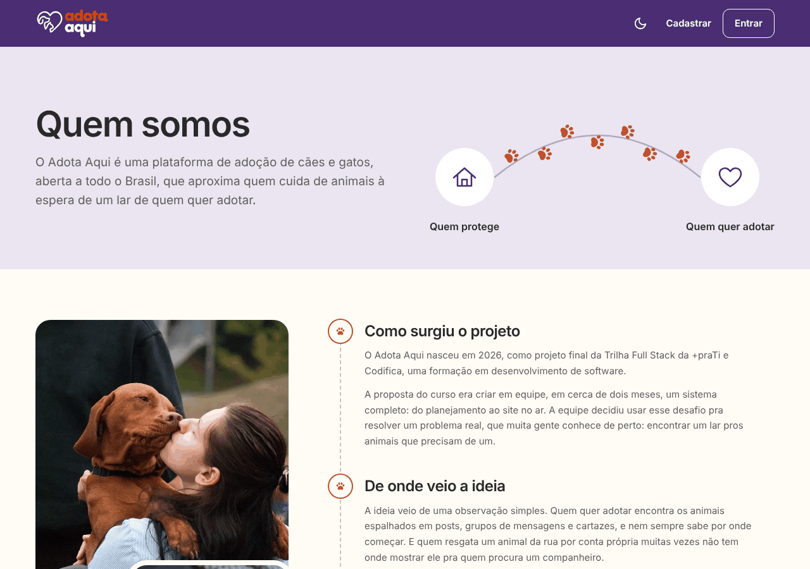

**O que faz.** Conta como o projeto surgiu, de onde veio a ideia, o que motiva o time e o que o Adota Aqui se propõe a fazer. Por enquanto, sem o nome de quem desenvolveu.

**Como funciona.**

1. A página fica em `/quem-somos` e no rodapé ("Quem somos"). Tem quatro partes: como surgiu o projeto, de onde veio a ideia, o que motiva a gente e o que o Adota Aqui se propõe a fazer, com o lembrete de que a decisão final é sempre de quem cuida do animal.
2. No fim, "Quer fazer parte?" leva pra vitrine, pra página de abrigos e protetores e pro cadastro de animal.
3. O visual: uma faixa lilás no topo com o desenho da "ponte" (uma casinha de um lado, um coração do outro e pegadas atravessando o arco), duas fotos ao lado da história (uma moça beijando o cachorro e um gato dormindo em casa), uma trilha pontilhada com uma patinha em cada parte da história, a proposta em cinco cartões com ícone numa faixa roxa (como o "Como funciona" da Home) e um gatinho no colo no cartão do fim. As fotos são de banco de imagens gratuito e só aparecem nesta página (`assets/fotos/quem-somos-*.webp`).
4. As animações: o arco se desenha e as pegadas aparecem uma depois da outra quando a página abre, e cada parte sobe de leve quando entra na tela. Quem pediu menos movimento no sistema vê tudo parado, e o navegador que não sabe animar pela rolagem mostra as partes prontas. O desenho e as fotos são enfeite (`aria-hidden` e `alt` vazio), então o leitor de tela pula.
5. A Home termina com a seção "Conheça o Adota Aqui", depois dos passos da adoção, com o botão "Conhecer o projeto".

**Onde está no código.** `pages/QuemSomos` (os textos ficam todos no começo do arquivo, pra ficar fácil de mudar), `components/PonteDaAdocao` (o desenho do topo), `components/Pata` (a pegada, usada no desenho e na trilha), as animações no fim do `styles/index.css` e `components/ConhecaOProjeto`.

**Testes.** `QuemSomos.test.jsx`, `Home.test.jsx`, `App.test.jsx` e `Rodape.test.jsx`.

---

## 16. Clínicas veterinárias perto de você

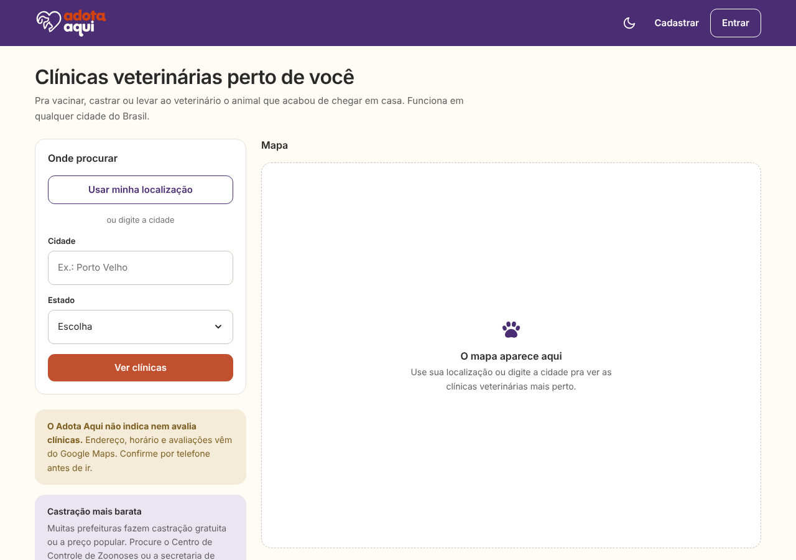

**O que faz.** Mostra num mapa as clínicas veterinárias perto de quem adotou ou vai adotar, em qualquer cidade do Brasil. Era uma das ideias do tutor que tinham ficado fora do escopo (ERS 6.10).

**Como funciona.**

1. A página fica em `/clinicas`, aberta pra qualquer pessoa, com link no rodapé ("Clínicas veterinárias") e no perfil do animal ("Vai adotar? Veja as clínicas veterinárias perto de {cidade}").
2. O lugar vem de quatro jeitos: o botão "Usar minha localização" (o navegador pede permissão), a cidade e o estado digitados, a cidade do animal (pra quem chega pelo perfil dele) ou, pra quem está logado, a cidade do perfil da conta.
3. O mapa é o do Google, embutido na página e já buscando "clínica veterinária" naquele lugar. Nome, endereço, telefone, horário, avaliações e rota vêm do próprio Google. Os botões "Todas as clínicas" e "Atendimento 24 horas" trocam a busca.
4. "Abrir no Google Maps" abre a mesma busca no Maps, em outra aba. No celular, abre o app.
5. Depois de escolher o lugar, a tela vai pro mapa (no celular ele fica embaixo da busca) e o foco vai pro título dele, que diz o lugar novo.
6. Do lado do mapa (no celular, embaixo), o aviso de que o site não indica nem avalia clínicas e a dica de procurar a castração gratuita ou a preço popular da prefeitura.

**Regras.**

- O site não guarda nada: nem as clínicas, nem o lugar da pessoa. Nada passa pela nossa API.
- A cidade digitada vai pro endereço da página (`/clinicas?cidade=Recife&estado=PE`), então dá pra mandar o link pra alguém. A localização não vai: o ponto é arredondado em uns 100 metros e só vai pro Google.
- A cidade que vem no link vale mais que a do perfil.
- O mapa usa o formato de incorporar do Google, sem chave. O porquê, e o que fazer se o Google parar de aceitar, está em [aspectos relevantes](aspectos-relevantes.md#o-mapa-de-clínicas-é-o-do-google-embutido).

**Onde está no código.** `pages/Clinicas`, `utils/clinicas.js` (os endereços do Google), o link em `pages/PerfilAnimal`, o `href` do `components/Botao` (link pra fora do site, que abre em outra aba) e o rodapé.

**Testes.** `Clinicas.test.jsx`, `clinicas.test.js`, `PerfilAnimal.test.jsx`, `App.test.jsx` (a rota), `Botao.test.jsx` e `Rodape.test.jsx`. O mapa de verdade é conferido à mão (CT-CLI-04).

---

## 17. Feiras de adoção

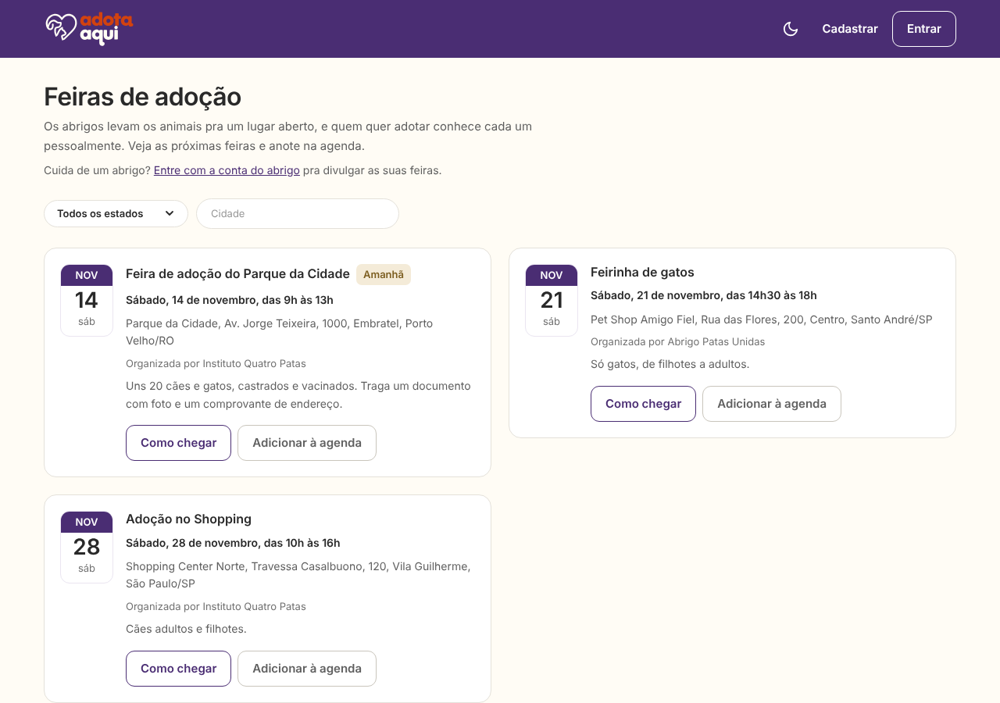

**O que faz.** Mostra as feiras de adoção que ainda vão acontecer: o dia, o horário e o lugar em que um abrigo leva os animais pra quem quer adotar conhecer pessoalmente. Só abrigo divulga feira.

**Como funciona.**

1. A página fica em `/feiras`, aberta pra qualquer pessoa, com link no rodapé ("Feiras de adoção"). Quem está logado já abre no estado do perfil, e dá pra trocar pra outro estado ou "Todos os estados" e procurar pela cidade.
2. Cada card tem a folha do calendário (mês, dia e dia da semana), o título, a data por extenso com o horário ("Sábado, 21 de novembro, das 9h às 13h"), o local com o endereço, o abrigo que organiza e a descrição. A feira de hoje e a de amanhã ganham o selo "Hoje" ou "Amanhã".
3. "Como chegar" abre o endereço no Google Maps, e "Adicionar à agenda" abre o Google Agenda com a feira já preenchida, no fuso da cidade dela (uma feira em Porto Velho às 9h fica às 9h de Porto Velho, mesmo pra quem está em São Paulo). Os dois abrem em outra aba e não precisam de chave.
4. O abrigo logado vê "Divulgar uma feira", que abre o formulário (`/feiras/nova`) com a cidade e o estado do abrigo já preenchidos. Nas feiras dele aparecem "Editar" e "Apagar", e o apagar pede confirmação no próprio card.
5. A Home mostra as duas próximas feiras do Brasil depois da vitrine, com "Ver todas as feiras". Sem feira marcada, a seção some.
6. Sem resultado, aparece "Nenhuma feira marcada em {estado} por enquanto." e o botão "Ver feiras de todo o Brasil".

**Regras.**

- Só abrigo divulga, e só o abrigo que divulgou edita e apaga. A pessoa física que abre `/feiras/nova` volta pra lista, e a API responde `403` se alguém tentar direto.
- A data não pode ter passado, e o horário de fim tem que vir depois do de início. O front confere antes de enviar, e o back confere de novo.
- A lista mostra as feiras de hoje em diante, da mais próxima pra mais distante. A de hoje fica até o fim do dia, no horário de Brasília.
- A feira mostra do abrigo só o nome, como a vitrine. Contato continua saindo só pelo interesse num animal.

**Por que só abrigo.** Feira de adoção junta muita gente e muitos animais num lugar público, e quem organiza costuma ser abrigo ou ONG. Deixar qualquer conta divulgar abriria espaço pra evento falso marcando encontro com desconhecidos, e o site não tem moderação.

**Onde está no código.**

- Front: `pages/Feiras`, `pages/FormularioFeira`, `components/CardFeira`, `components/ProximasFeiras`, `services/feiras.js`, `utils/feiras.js` (datas, horário, fusos e links do Google) e a `RotaProtegida apenasAbrigo`
- Back: `FeiraController`, `FeiraService`, `FeiraRequest`, `FeiraFiltroRequest`, `FeiraResponse`, `FeiraRepository`, `FeiraSpecifications` e o modelo `FeiraDeAdocao`

**Como fica no banco.** Tabela nova `feira_de_adocao`, ligada ao abrigo, com o `CHECK` de que o fim vem depois do início ([diagramas, seção 9](diagramas/diagramas-adota-aqui.md#9-feiras-de-adoção)). O Hibernate cria a tabela sozinho no deploy.

**Testes.** `FeiraIntegrationTest` (quem divulga, a lista só com as próximas e na ordem, filtros sem acento, validações, quem edita e apaga), `Feiras.test.jsx`, `FormularioFeira.test.jsx`, `ProximasFeiras.test.jsx`, `feiras.test.js`, `App.test.jsx` (as rotas e quem entra no formulário) e `Rodape.test.jsx`.

---

## 18. Observatório da adoção

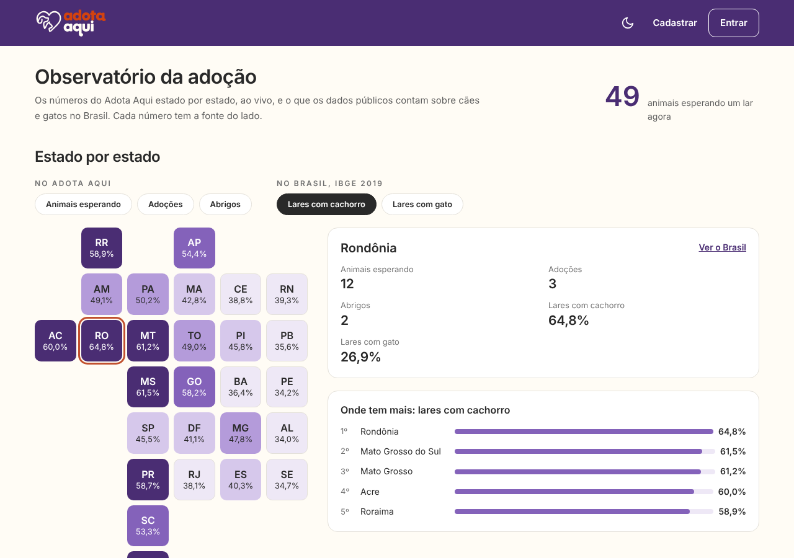

**O que faz.** Mostra os números do Adota Aqui estado por estado, ao vivo, junto com dados públicos sobre cães e gatos no Brasil, cada um com a fonte. Era uma das ideias do tutor que tinham ficado fora do escopo (ERS 6.8, dados pra políticas públicas).

**Como funciona.**

1. A página fica em `/observatorio`, aberta pra qualquer pessoa, com link no rodapé ("Observatório da adoção"). No topo, o total de animais esperando um lar agora.
2. O mapa do Brasil é um mosaico: cada estado é um quadrado, no lugar aproximado dele, com a sigla e o número. Os botões trocam o que o mapa mostra. "No Adota Aqui" tem animais esperando, adoções e abrigos, que vêm da API. "No Brasil, IBGE 2019" tem a porcentagem dos lares com cachorro e com gato.
3. As cores são um roxo só, do claro (pouco) ao escuro (muito), com a legenda "menos" e "mais". Estado sem nenhum número do site fica só com o contorno tracejado ("nenhum ainda"). No tema escuro o mapa inverte: pouco fica perto do fundo, e muito, mais claro.
4. Tocar num estado mostra do lado os números dele, do site e do IBGE. Embaixo vem o ranking dos 5 estados com mais da medida escolhida e, pra quem prefere, todos os estados numa tabela.
5. "O retrato no Brasil" traz números públicos com a fonte e a data: lares com cachorro e gato (IBGE), animais em situação de vulnerabilidade e sob cuidado de ONGs (Instituto Pet Brasil) e castrações gratuitas do ProPatinhas (governo federal). Depois, a Lei 14.064/2020, como denunciar maus-tratos e o link pro SinPatinhas, o RG gratuito de cães e gatos.

**Regras.**

- Os números do site vêm do `GET /api/estatisticas/estados`, com as mesmas contas da Home. Animais e adoções contam onde o animal está; abrigos, o endereço do abrigo.
- Os dados públicos ficam no código (`utils/observatorio.js` e a página), com a fonte e a data, porque nenhuma dessas fontes tem uma API simples. Número sem fonte não entra.
- Se a API falhar, o mapa do IBGE continua funcionando, e os números do site ganham o "Tentar de novo".

**Por que mosaico e não o desenho dos estados.** O desenho de verdade precisaria de uma biblioteca de mapas e do arquivo com as fronteiras, e os estados pequenos (como o DF e Sergipe) quase sumiriam. No mosaico, todo estado tem o mesmo tamanho, dá pra tocar no celular e cada quadrado é um botão com o nome e o número pro leitor de tela.

**Onde está no código.**

- Front: `pages/Observatorio`, `components/MapaDoBrasil` (o mosaico e a legenda), `utils/observatorio.js` (o lugar de cada estado, a tabela do IBGE, os tons e o ranking), `services/estatisticas.js` e as cores `--mapa-1` a `--mapa-5` no `styles/index.css`
- Back: `EstatisticasController`, `EstatisticasService` (`porEstado`), `EstatisticasResponse.PorEstado`, `ContagemPorEstado` e as contagens em `AnimalRepository`, `InteresseRepository` e `AbrigoRepository`

**Testes.** `EstatisticasIntegrationTest` (os 27 estados e as contas por estado), `Observatorio.test.jsx`, `observatorio.test.js`, `App.test.jsx` (a rota) e `Rodape.test.jsx`.

---

## 19. O que ainda não está pronto

| O quê                                   | Situação                                                                                                                                       |
| --------------------------------------- | ---------------------------------------------------------------------------------------------------------------------------------------------- |
| Foto de um cadastro que não foi salvo   | Quem envia fotos e desiste do formulário sem salvar deixa os arquivos no S3. Limpar essas fotos pediria uma tarefa agendada que procura arquivo sem animal |

O que ficou de fora do escopo, e por quê, está em [aspectos relevantes](aspectos-relevantes.md#o-que-ficou-de-fora).

---

## Como atualizar este documento

1. Funcionalidade nova ganha uma seção nova, com as mesmas partes: o que faz, como funciona, regras, onde está no código, testes e print.
2. Os prints ficam em `docs/prints/`, com número e nome da tela (por exemplo, `14-minhas-candidaturas.png`). Pode ser do site de verdade ou do ambiente local.
3. Mudou uma regra? Atualiza aqui e no `api.md` no mesmo PR.
