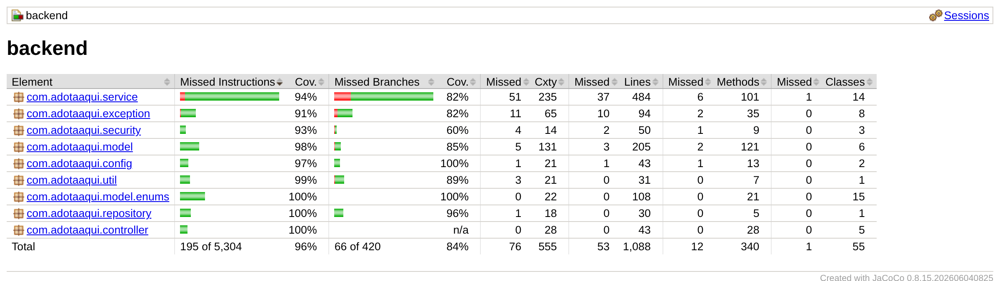
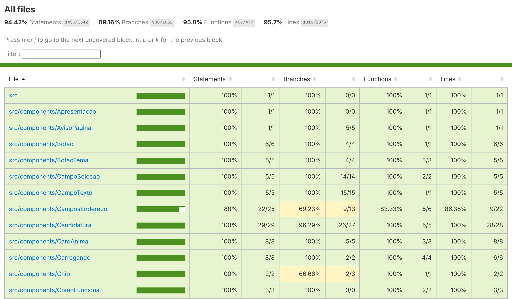

# Relatório final de testes

Fechamento da issue #47: todos os testes rodados uma última vez e a cobertura guardada como prova do mínimo de 70% (RNF04). O [plano de testes](plano-de-testes.md) explica como a equipe testa, e os [casos de teste](casos-de-teste.md) dizem o que precisa funcionar do ponto de vista de quem usa o site.

## Resultado

Medido pelo CI do GitHub na `main`, no commit `3025d54` (16/11/2026, o merge da #169), que é a versão 1.5.1, a apresentada em 16/11: [execução no GitHub Actions](https://github.com/HayrineQueirozdeLima/Adota-Aqui/actions/runs/43798890222). Os relatórios completos de cobertura estão nos artefatos dessa execução (`cobertura-backend` e `cobertura-frontend`) até 14/02/2027.

|                          | Back (JUnit 5 e JaCoCo) | Front (Jest e Testing Library) | Mínimo do curso |
| ------------------------ | ----------------------- | ------------------------------ | --------------- |
| Testes                   | 232, em 24 classes      | 427, em 49 arquivos            | -               |
| Linhas cobertas          | **95,8%**               | **95,01%**                     | 70%             |
| Ramos cobertos (if/else) | 80,4%                   | 87,3%                          | -               |
| Resultado                | Todos passando          | Todos passando                 | -               |

Na entrega de 29/10 (commit `df6a2fa`, [execução](https://github.com/HayrineQueirozdeLima/Adota-Aqui/actions/runs/40805883527)) eram 130 testes no back e 207 no front, com 95,1% e 95,7% das linhas cobertas. Os testes novos vieram com o que entrou depois da entrega (versões 1.0.1 a 1.5.1 do [CHANGELOG](../CHANGELOG.md)), e a cobertura ficou acima de 95% nos dois lados.

O CI barra qualquer PR que deixe a cobertura de linhas abaixo de 70%, no back (JaCoCo) e no front (Jest). Então todo commit que está na `dev` e na `main` já passou por essa régua.

## O que os testes cobrem

O curso pede testes dos componentes críticos e dos casos de uso principais, como o CRUD e a autenticação. A divisão abaixo é por funcionalidade, com a quantidade de testes de cada arquivo:

| Funcionalidade | Back | Front |
| --- | --- | --- |
| Cadastro, login e sessão (RF01 a RF03) | `AutenticacaoIntegrationTest` (18) | `Cadastro.test.jsx` (13), `Login.test.jsx` (7), `AuthContext.test.jsx` (6) |
| CRUD de animal e fotos (RF04 a RF06, RF16) | `AnimalIntegrationTest` (30), `FotoIntegrationTest` (7) | `CadastroAnimal.test.jsx` (14), `EditarAnimal.test.jsx` (12), `FormularioAnimal.test.jsx` (11), `MeusAnimais.test.jsx` (7) |
| Vitrine, perfil do animal, compartilhar e protetores (RF07, RF14) | `RacaIntegrationTest` (4), `ProtetorIntegrationTest` (7) | `VitrineAnimais.test.jsx` (22), `PerfilAnimal.test.jsx` (20), `CardAnimal.test.jsx` (11), `CompartilharAnimal.test.jsx` (7), `Protetores.test.jsx` (11), `Home.test.jsx` (8) |
| Interesse, aprovação, candidaturas e devolução (RF08 a RF10, RF13, RF15) | `InteresseIntegrationTest` (36), `DevolucaoIntegrationTest` (4) | `DemonstrarInteresse.test.jsx` (11), `InteressesRecebidos.test.jsx` (21), `MeusInteresses.test.jsx` (19) |
| Perfil da conta e foto de perfil (RF17) | `PerfilIntegrationTest` (16) | `Perfil.test.jsx` (21), `FotoDoPerfil.test.jsx` (7) |
| Histórias de adoção, blog e números do site | `DepoimentoIntegrationTest` (9), `ArtigoIntegrationTest` (8), `EstatisticasIntegrationTest` (4) | `Historias.test.jsx` (5), `EscreverDepoimento.test.jsx` (6), `Blog.test.jsx` (10), `Artigo.test.jsx` (6), `FormularioArtigo.test.jsx` (9), `Estatisticas.test.jsx` (4) |
| Feiras, clínicas e observatório | `FeiraIntegrationTest` (6) | `Feiras.test.jsx` (8), `FormularioFeira.test.jsx` (9), `ProximasFeiras.test.jsx` (3), `feiras.test.js` (6), `Clinicas.test.jsx` (13), `clinicas.test.js` (11), `Observatorio.test.jsx` (5), `observatorio.test.js` (6) |
| Ajudas com IA | `IaIntegrationTest` (7), `ClienteGeminiTest` (10) | `MeAjudaAEscolher.test.jsx` (7), `EscreverComIa.test.jsx` (5) |
| Regras do banco e dos dados | `IntegridadeDoBancoTest` (6), `RegrasDasEntidadesTest` (8), `DtoValidationTest` (9), `RacaTest` (4), `DocumentoUtilsTest` (19) | `Validacoes.test.jsx` (11), `triagem.test.js` (4), `rotulos.test.js` (12) |
| Erros, deploy, documentação da API e o resto da tela | `ErroApiIntegrationTest` (7), `GlobalExceptionHandlerTest` (2), `ConferenciaDoDeployTest` (7), `DocumentacaoDaApiIntegrationTest` (3), `AdotaAquiApplicationTests` (1) | `App.test.jsx` (13), `Navbar.test.jsx` (13), `Rodape.test.jsx` (3), `Botao.test.jsx` (3), `BotaoTema.test.jsx` (3), `RolarParaOTopo.test.jsx` (4), `carregando.test.jsx` (1), `QuemSomos.test.jsx` (5), `Animacoes.test.jsx` (7), `RastroDePatas.test.jsx` (4), `TrilhaDePatas.test.jsx` (1), `curva.test.js` (2) |

Os testes do back que terminam em `IntegrationTest` sobem o Spring inteiro, com o banco H2 em memória, e chamam os endpoints pelo MockMvc: cada pedido passa pelo Spring Security, pelo token, pelas validações e pelo banco, como os pedidos do site. Os do front usam uma API de mentira (`tests/utils/apiFalsa.js`) e conferem o que é trabalho da tela: mandar o pedido certo, mostrar a resposta e cada mensagem de erro.

Os casos manuais dos [casos de teste](casos-de-teste.md) não entram nessa conta. A responsividade (CT-NAV-02) foi conferida no bug bash da #44, descrito no plano de testes, junto com o foco visível pelo teclado em todas as telas (parte do CT-NFR-06). Preencher e enviar os formulários só pelo teclado e o tempo de carregamento (CT-NFR-01, pelo Lighthouse do Chrome, no site publicado) ficam pra rodada manual da véspera.

## Como rodar e guardar a prova

1. Rode na sua máquina, se quiser ver antes do CI:

   ```bash
   cd backend && mvn verify              # testes + JaCoCo + a régua de 70%
   cd ../frontend && npm run test:coverage
   ```

   O relatório do back fica em `backend/target/site/jacoco/index.html` e o do front em `frontend/coverage/lcov-report/index.html`.

2. Depois do último PR da `dev` pra `main`, abra no GitHub a aba Actions e a execução do CI desse merge.
3. No resumo (Summary) estão a cobertura do back e a do front. Atualize a tabela "Resultado" com esses números, o commit e o link da execução.
4. Ainda na execução, em Artifacts, baixe `cobertura-backend` e `cobertura-frontend`. Abra o `index.html` de cada um e tire um print da primeira tela, com o total.
5. Salve os prints em `docs/prints/cobertura-back.png` e `docs/prints/cobertura-front.png`, no lugar dos que estão lá. O GitHub apaga os artefatos depois de 90 dias, e o print fica no repositório.

Os prints abaixo são os da entrega de 29/10. Os números da versão final são os da tabela "Resultado", e os relatórios completos estão nos artefatos da execução de 16/11.




